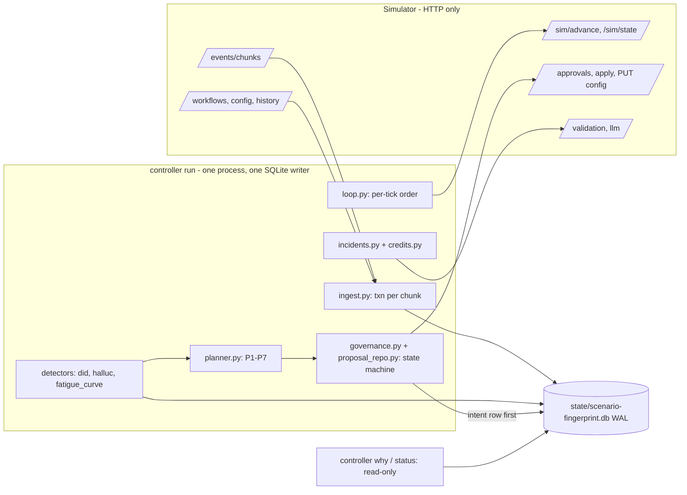

# Outcome-First Agent Loop — Submission

**Name:** Naman Rana · **Date:** 2026-11-06 (floor-checkpoint draft) · **Hours actually spent (be honest):** ~16 so far, estimated, see `docs/TIMELOG.md` (candidate to confirm) · **Language / storage:** Python 3.13, SQLite (WAL)

> DRAFT at the floor checkpoint (Phase 4). Sections marked `TODO (phase N)` are placeholders for later
> phases; every number below was checked against `reports/`, `settings.py` or a command run for this draft.

---

## 0. TL;DR
- A single-process controller (`python -m controller run`, wrapped by `run.sh`) talks to the simulator only over HTTP: it ingests events into SQLite, detects bad caller IDs (DIDs) and hallucination spikes, and changes config only through the governance API (auto-apply where the policy allows, approvals otherwise).
- Every proposal is written to the store before it is sent, so a kill at any point resumes without double-applying (crash test below: 4 fault points + 3 hard kills on public_02, all invariants pass).
- public_02 (`reports/public_02_incidents.md`): 12 changes applied (7 beneficial, 5 neutral, 0 harmful), flagged-DID share 0.073 on Day 2 then 0.0 from Day 3, the supervisor's bad prompt edit reverted through an approval in 165 min, `lapsed`/`apply_conflicts`/`auto_apply_rejected` all 0, 9 credits (3 validations, 0 LLM calls).
- public_01 (`reports/public_01_dev.md`): 8 changes (3 beneficial, 5 neutral, 0 harmful), conclusion rate +7.4% vs baseline, engagement -0.1% overall (not yet optimised: experiments are phase 6).
- Not built yet: cohorts, per-cohort call time, welcome/voice experiments, decay/rollback, supervisor view, scale run (phases 5-10). Cut: tenant-fair allocation (C15), prompt experiments outside incidents.

## 1. Assumptions
1. **A1** The controller knows only what the HTTP API returns. Sim code was read to learn the contract (validation, grading), never imported by `controller/`, and no numbers from the hidden truth are constants.
2. **A2** IST throughout; "Day 3 14:00" = sim minute 3*1440+840 (Day 0 = 2027-01-04, `settings.EPOCH_DATE`).
3. **A3** `*_max_drop: 0.02` is an absolute 2-point drop in the guardrail rate versus the concurrent control (or the pre-change baseline if there is none).
4. **A4** "Who approved" = the workflow's policy approver, identified by `approval_id` and the sim's `decided_at`; the simulator exposes no personal names. `why` says exactly that.
5. **A5** `max_shift` limits the speed of change: at most one auto-apply step per workflow per hour (`AUTO_APPLY_MIN_GAP_MINUTES = 60`), per tick in incident mode (`AUTO_APPLY_INCIDENT_GAP_MINUTES = 15`); steps are never chained within a tick.
6. **A6** Supervisor edits are legitimate and never silently reverted; a revert is proposed through the approver, naming the edit and the evidence.
7. **A7** Anita's limits (<= 2 requests/day, none before 11:00) are a soft preference on top of policy (`settings.SOFT_CAPS["ks_cancel"]`); incidents may use the reserved slot.
8. **A8** Hidden scenarios may change options, policies, incidents, prompts and history length (including 0); everything is read from `GET /workflows` at runtime and each capability needs a cold-start rule.
9. **A9** Priors, tunable and documented: `DID_H_FLOOR = 0.35` (worst plausible DID health, only used by the probe cap), `DID_PROBE_BASE_STEP = 0.015`, `DID_PASS_RATIO = 0.8`, `DID_FLAG_MIN_DROP = 0.30`.
10. **A10** (new) Per-look significance levels are tighter than the spec's p < 0.001 because the tests re-run every 15-minute tick: DID step test `DID_FLAG_P = 1e-5` (about 100 looks per DID-day), hallucination `HALLUC_P = 1e-4` (fresh prompt segment) and `HALLUC_P_DRIFT = 1e-5` (same prompt, drift).
11. **A11** (new) An allocation move smaller than `DID_MIN_TV = 0.005` is not auto-applied and smaller than `DID_MIN_TV_APPROVAL = 0.03` is not worth an approval slot.
12. **A12** (new) An applied proposal is monitored for `MONITOR_MINUTES = 1440` and then closed; "closed" ends our monitoring window, it does not certify the change as beneficial.
13. **A13** (new) Credit policy: reserve `CREDIT_RESERVE_PER_WORKFLOW = 25` per workflow for incidents; one incident may spend at most `INCIDENT_CREDIT_CAP = 25`; Day-0 validation of each live prompt (`HALLUC_VALIDATION_N = 300`, 3 credits each).
14. **A14** (new) A simulator that restarts is a new world: the DB is keyed by scenario + fingerprint of the first history chunk (`world_id.py`); a regressed sim minute, chunk count or last event id archives the old DB.
15. **A15** (new) When a supervisor config version is superseded within one advance, its body cannot be recovered (the API returns no bodies); we mirror bodies after every `config_changed` event and accept this limitation.

## 2. Scope decisions
Status is what exists in the repo today ("Planned (phase N)" = designed in `docs/CONTEXT.md`, not built, feature flag off).

| # | Capability | Built / Partial / Cut | Why | What it would take to finish |
|---|---|---|---|---|
| C1 | Ingestion at load scale | Built | Spine; crash safety and the SRE target depend on it. One txn per chunk, `event_id` primary key; one public_03 day measured at 485 s total (`reports/phase1_ingest_timing.md`) | Stream chunks instead of buffering (peak 1.58 GB), re-measure in phase 8 |
| C2 | One shared cohort object | Partial | `cohorts.py` evaluates the sim's cohort rules and self-checks every call's `cohort_id` (a mismatch raises an alert); no cohorts are defined yet | Planned (phase 5): data-driven partition from history |
| C3 | History bootstrap | Built | Baselines (`baselines.py`), DID load-fatigue curve (`detectors/fatigue_curve.py`), flag baselines | Cold start (`history_days = 0`) is a daily recompute, exercised only in unit tests |
| C4 | Call-time optimisation | Planned (phase 5); C4b analysis-only (phase 9) | `ENABLE_SCHEDULE = False` | Cohorts first, then per-cohort hour weights |
| C5 | Caller-ID health | Built | Biggest pickup lever; the public_02 incident | Weekly re-probe of flagged DIDs is not built |
| C6 | Welcome x voice experiments | Planned (phase 6) | `ENABLE_EXPERIMENTS = False` | Stats (OBF/Holm/clustered SE) then allocation logic |
| C7 | Promotion, decay, rollback | Planned (phase 6) | Depends on C6 | CUSUM + holdout |
| C8 | Hallucination incidents | Built | MTTR is graded; 165 min on public_02 | The `suggest-fixes` fallback is implemented but not exercised on public_02 (0 LLM calls) |
| C9 | Governance client + planner | Built | Every change goes through it; hygiene is graded | Experiment and schedule producers plug into the same planner |
| C10 | Impact, affected leads, dry run | Partial | Required fields; `dryrun.py` replays the last 3 days of the cube; unobserved arms labelled `no_evidence`; impact is a clipped lower-bound lift | Honest CI for schedule changes (phase 5) |
| C11 | Supervisor view | Planned (phase 7) | Separate read-only process, never started by `run.sh` | `view.py`/`ui.py` over the same DB |
| C12 | Audit store | Built | Floor requirement; `why --at / --from --to / --lead` (section 10) | Per-person view, UI link |
| C13 | Crash recovery, demonstrated | Built (floor version) | 4 fault points + 3 hard kills pass (section 9) | Phase 8: 10 random kills, public_01, Linux run |
| C14 | Loop observability | Partial | `metrics` table (events, ingest wall time, lag, tick time), `controller status` (JSON), `alerts` table | Alert rules, in-flight deadlines in `status` (phase 7) |
| C15 | Fair allocation across tenants | Cut | Budgets are already per workflow; matters at hundreds of tenants | Global coordinator for credits and approver attention |

**Principle:** spine first (ingest, governance, audit, crash safety), then the levers with the most defensible lift per approval spent (caller-ID health and hallucination fixes, which also have the clearest incidents), then reach. Everything optional sits behind a flag that stays off until its phase is green, so a half-built engine never ships enabled.

## 3. Stakeholders
(Checked against the actual workflow policies in `docs/CONTEXT.md` section 3. "Built" refers to the repo today.)

### 01 Sales (Nikhil)
- **Accepted:** batching of routine requests (planner P1: one in-flight approval per workflow; a `daily_bundle` job once per sim day; built); lift reported separately per KPI (no blended score anywhere, R4).
- **Pushed back:** a blended score; "winning by lunch, live by evening" (no minimum sample, approver latency 30-480 min, nw_kyc cannot change mid-campaign); rolling P4 out everywhere.
- **Wrong against policy:** "Kestrel turned on auto-apply for everything": ks_cancel allows only schedule, caller_id, welcome and voice at max_shift 0.2, no prompt, no cohorts. "Northwind is fine with auto-apply on KYC": nw_kyc has `auto_apply.enabled: false`. P4 is not an option on nw_kyc.
- **Reply:** Nikhil, thanks. We report pickup and engagement per workflow separately; there is no blended score. Batching is built: at most one routine request in flight per workflow. We cannot promise "winning by lunch, live by evening": a winner needs a minimum sample, the approver takes 30-480 minutes inside working hours, and nw_kyc only changes at the next campaign. Two claims do not match the policies: Kestrel's auto-apply covers only schedule, caller ID, welcome and voice (not prompts or cohorts), and Northwind's nw_kyc has auto-apply switched off, so even caller-ID rotation needs an approval there. P4 is not available on nw_kyc, so we will not roll it out there.

### 02 Compliance (Meera, Northwind)
- **Accepted:** named approval for customer-facing changes (prompt changes go through an approval with validation evidence; built); the per-customer "why did they hear X" answer (`why --lead`, built); no night-time requests (`fatigue.filing_window_ok`, built); weekly summary of operational auto-applies (planned, phase 7).
- **Pushed back:** nothing.
- **Wrong against policy:** "call timing and caller-ID rotation are covered by the policy we signed": true for nw_renewal, false for nw_kyc (auto-apply disabled). The sim exposes no approver names (A4), so we record approval id and decision time, not a person.
- **Reply:** Meera, thank you. Every customer-facing change goes through your approver with its evidence attached, and requests are only filed inside approver hours. `controller why --lead <id> --day N` already shows, per customer, each call with the welcome, voice, caller ID and prompt used, plus the decision and approval behind them. One correction: timing and caller-ID rotation are covered by auto-apply on nw_renewal, but not on nw_kyc, where auto-apply is disabled, so every caller-ID change there is requested from your approver. The system records the approval id and decision time; it cannot see the approver's personal name.

### 03 Platform/SRE (Kabir)
- **Accepted:** kill/restart test (`scripts/crash_test.py`, section 9); idempotency (write-ahead proposal ids); one DB file with `status` for health; the <10 min per sim day target (one public_03 day: 485 s total including sim compute and the history ingest, Phase 1 measurement).
- **Pushed back:** Postgres for the assignment. SQLite is an embedded file with no daemon; the schema is plain SQL and ports to Postgres (partition `calls` and `cube` by day).
- **Wrong against policy:** nothing found.
- **Reply:** Kabir, the kill/restart test exists (`scripts/crash_test.py`, log in `reports/crash_test.log`): every fault point plus random hard kills, then invariant checks over HTTP and our store. Proposal ids are written before anything is sent, so retries are idempotent. We use SQLite for the assignment because it is a single embedded file with no daemon to run on a 4 vCPU box; the schema is plain SQL and would port to Postgres, partitioned by day. One public_03 sim day measured 485 s including the sim's own compute and a 5.5M-event history ingest, under your 10 minutes. We have not yet measured 10x; that is on the list.

### 04 Ops supervisor (Anita, Kestrel)
- **Accepted:** never silently undo her edits (A6; the public_02 revert is an approval request that names her Day 3 11:30 edit); soft cap of 2 requests/day and none before 11:00 (`settings.SOFT_CAPS`, built); no "strict script" fix (the revert target is a known-good prompt and engagement is verified after apply); one screen (planned, phase 7).
- **Pushed back:** one reserved incident slot beyond her 2/day; operational DID/schedule changes happen without advance notice and are listed under "changed today" (planned, phase 7).
- **Wrong / mismatched:** she asks to be told before changes; we meet it by routing customer-facing changes through her approver. Her ask contradicts Sales' claim that Kestrel wants everything automatic.
- **Reply:** Anita, your edits are never overwritten silently. When the hallucination rate on your Day 3 prompt edit rose from 1.4% to 5.2%, we did not revert it behind your back: we filed one approval request naming your edit, the numbers and the validation run, and checked engagement afterwards. Routine requests are capped at two a day and none before 11:00. We keep one extra slot for incidents, and operational caller-ID or schedule changes happen without a request, so they will appear in a "changed today" list. The one-screen view is not built yet; it comes next.

### 05 Product (Tara)
- **Accepted:** separate KPIs; one shared cohort object (partial, phase 5); every proposal carries summary, rationale, impact, affected leads and a dry run (built, validated locally before sending); expired = rejection, re-planned with fresh data (state machine, built); only observed arms count (`no_evidence`); per-workflow promotion only.
- **Pushed back:** the three P0s cannot all ship at full depth. Per-cohort call time ships (phase 5); per-person call time is analysis-only (phase 9). That is the "thing we cut", with reasons in CONTEXT section 6.
- **Wrong against policy:** none factual. Caveat: prompt changes have no historical dry run (one prompt per workflow), so they are labelled validation-only.
- **Reply:** Tara, KPIs stay separate everywhere, and each request carries a summary, rationale, impact score, affected leads and a dry run built from observed data; arms never observed are labelled "no evidence" rather than guessed. Expired requests are treated as rejections and re-planned with fresh data. The three P0s cannot all ship at full depth in the time: per-cohort call time is planned, per-person call time will be analysis-only, because there are only 1-2 connects per person and a person-level holdout competes with the treated group for the same capacity. Prompt changes show "validation-only" because there is no historical dry run for them.

### 06 CTO (Aryamann)
- **Accepted:** explainable over impressive (deterministic rules, every decision a row in `decisions`); credits only where they change a decision (Day-0 validations are the whole spend on public_02: 9 credits); the scale envelope (section 8, TODO); a written "no" for each cut (sections 2 and 12); on-call docs (planned, phase 10).
- **Pushed back:** nothing.
- **Wrong against policy:** he warns the memos contain errors; confirmed, listed above.
- **Reply:** Aryamann, you were right that the memos disagree with the policies; the corrections are in the Sales, Compliance and Ops replies. Every change is a deterministic rule and a row in our own store that `controller why` can replay. Credits are spent only on Day-0 prompt validation (9 credits across three validation runs on public_02, 0 LLM calls). The cuts are written down with reasons: tenant-fair allocation, prompt experiments outside incidents, per-person call-time deployment. The scale numbers and the on-call runbook are still to come, and this draft says so.

## 4. Architecture



Per tick (`loop.py`): reconcile in-flight approvals -> ingest new chunks and mirror configs -> apply approved changes (only if `apply_by` has not passed and the base version is current; otherwise mark LAPSED/STALE locally and never call `/apply`) -> detectors -> planner and submit -> metrics row -> advance (15 min; 60 min when idle outside every dialling and approver window).

**State (SQLite WAL, `controller/schema.sql`):** `ingest_cursor`, `leads`, `calls` (event_id primary key), `cube` aggregates, `config_versions` (actor, proposal link, mirrored body), `proposals` + `proposal_events` (full state history), `decisions` (every detect/propose/apply with an inputs snapshot), `incidents`, `validation_runs` + `llm_calls` (credit ledger), `jobs`, `detector_state`, `alerts`, `metrics`, `meta` (world fingerprint).

**Restart behaviour:** open the DB for this world (a changed fingerprint or regressed sim opens a new one), re-read `/sim/state`, reconcile governance (INTENT proposals are looked up in `GET /approvals` by proposal id and resent verbatim if absent; APPROVED ones are applied if still valid; auto INTENTs are matched in `config/history`), re-ingest after the cursor (re-reading a chunk changes nothing) and continue. `run.sh` restarts a crashed controller (cap 20) and exits 0 only when the controller exits 0, which happens only once the sim reports finished.

## 5. The learning loop
TODO (phase 5-6): cohort formation and minimum size, welcome x voice allocation and the OBF/Holm winner rule with a measured false-winner rate, CUSUM decay and rollback, per-cohort call time, guardrail non-inferiority. Today only the caller-ID part exists: a fatigue curve fitted from history and live data (decay window chosen from `DID_FATIGUE_TAU_GRID_DAYS`), probe shares capped by `s <= 0.015 * h / (h - h_floor)`, a step test for flagged DIDs, and evacuation steps bounded by `max_shift`.

## 6. Governance
TODO (phase 6/10): the full state-machine diagram and the batching write-up. What exists today: states `DRAFT -> INTENT -> PENDING -> APPROVED -> APPLIED -> MONITORING -> CLOSED` with `REJECTED`, `EXPIRED`, `STALE`, `LAPSED`, `SUPERSEDED`, `SUBMIT_FAILED` branches (`proposal_repo.py`); every approval field is validated locally before sending (the sim only reveals soft failures at decision time); the rolling 24 h request ledger reserves the last slot for incidents (`fatigue.routine_budget`); requests are filed only in approver hours and only if the worst-case decision time precedes `expires_at`; operational caller-ID changes use auto-apply where the policy allows and the approval path otherwise (nw_kyc: `auto_apply.enabled: false`, hence nw_kyc v2-v4 on public_02 are `controller_approved`).

## 7. Incidents
**Thresholds as in `controller/settings.py`:**
- Flagged DID: a step drop of the DID's pickup ratio vs peers, two-proportion test at `DID_FLAG_P = 1e-5` per look, at least `DID_FLAG_MIN_DIALS = 150` dials on each side, windows of 1, 2 and 3 hours against the prior 24 h, relative drop of at least `DID_FLAG_MIN_DROP = 0.30`, share roughly unchanged (`DID_FLAG_SHARE_BAND = (0.5, 2.0)`). The test repeats every tick on three overlapping windows, hence the tighter level than the spec's 0.001 (A10).
- Hallucination: one-sided two-proportion test of the live prompt segment's flag rate against the last known-good prompt, `HALLUC_P = 1e-4` for a fresh segment and `HALLUC_P_DRIFT = 1e-5` for drift, at least `HALLUC_MIN_CONNECTS = 200` connects; a Day-0 validation below the workflow's minimum pass rate also opens an incident.
- **False-positive rate:** not measured yet (null-seed and Monte Carlo runs are phase 8). The per-look levels are conservative by construction; nothing more is claimed. In the public_01 report no incident appears.

**Choosing a fix:** revert to the last known-good prompt in the workflow's own record (its Day-0 validation run is the evidence, so no new credits); only if none exists, `suggest-fixes` plus validation of candidates ranked by lowest failure upper bound (implemented, not triggered on public_02).

**Credit spend:** public_02 used 9 credits: 3 validation runs at 3 credits (one Day-0 validation per workflow's live prompt, n=300) and 0 LLM fix calls (`reports/public_02_incidents.md`). A reserve of 25 per workflow is kept for incidents.

**Verify after apply:** `incident_verified` compares the new segment's flag rate with the baseline (`HALLUC_VERIFY_P = 0.01`, at least `HALLUC_VERIFY_MIN_CONNECTS = 200` connects) and checks engagement against the guardrail (`ENGAGEMENT_VERIFY_MAX_DROP = 0.02`); on failure the next candidate is tried. A DID incident closes when the flagged DID's share is 0 in the live config.

**Timeline, public_02 ks_cancel, Day 2 to Day 4**, produced by `python -m controller why --workflow ks_cancel --from "Day 2" --to "Day 4"` against the store of the crash-test run (section 9). That is a full public_02 run with kills, not the run behind `reports/public_02_incidents.md`; the two differ slightly because outcomes vary with restart timing. (The `to` bound is inclusive of the whole day, hence "to Day 5 00:00 exclusive".)

```
timeline ks_cancel from Day 2 00:00 to Day 5 00:00 (exclusive)
  Day 2 11:30  incident_opened: did_flagged incident opened
  Day 2 11:30  did_flagged: FLAGGED D2: pickup ratio vs peers fell 71% (p=4.9e-06, 199 dials in 2h vs 1641 in prior day); incident mode
  Day 2 11:30  proposal_auto_applied: ks_cancel:4:did_evacuation: AUTO_APPLIED
  Day 2 11:30  config_observed: v5 by controller_auto changed ['caller_id']
  Day 2 11:30  alert:did_flagged: FLAGGED D2: pickup ratio vs peers fell 71% (p=4.9e-06, 199 dials in 2h vs 1641 in prior day); incident mode
  Day 2 11:45  proposal_auto_applied: ks_cancel:5:did_evacuation: AUTO_APPLIED
  Day 2 11:45  config_observed: v6 by controller_auto changed ['caller_id']
  Day 2 12:00  incident_closed: did_flagged incident closed: D2 evacuated: share 0 in config v6
  Day 3 11:30  config_observed: v7 by supervisor changed ['prompt_version']
  Day 3 13:30  incident_opened: halluc incident opened
  Day 3 13:30  proposal_pending: ks_cancel:6:halluc_fix: PENDING
  Day 3 13:30  alert:halluc_incident: prompt_flag_spike: P2 flags 5.2% vs 1.4% (n=231, p=8.5e-07)
  Day 3 14:15  proposal_approved: ks_cancel:6:halluc_fix: APPROVED
  Day 3 14:15  proposal_applied: ks_cancel:6:halluc_fix: APPLIED
  Day 3 14:15  config_observed: v8 by controller_approved changed ['prompt_version']
  Day 3 16:45  incident_verified: P1: flags 2.26%, engagement ok
  Day 3 16:45  incident_closed: halluc incident closed: fixed by P1; flag rate back to baseline, engagement inside guardrail
```

Reading it: D2 is flagged at Day 2 11:30 (pickup ratio down 71% vs peers), evacuated in two auto-apply steps (v5, v6) within 15 minutes, and the incident closes at 12:00. The supervisor's prompt edit at Day 3 11:30 (v7) is detected two hours later (P2 flags 5.2% vs 1.4%), a revert approval is filed at 13:30, approved at 14:15 by our tick clock (the sim's `decided_at` is 13:55) and applied as v8 at 14:15; verification passes at 16:45. Time from the supervisor edit to the fix: 165 minutes (grader `mttr_minutes: 165`, `fixed_by: controller_approved`).

## 8. Scale
TODO (phase 8): load numbers for public_03 (events/s, decision lag, peak memory, wall time per day) and the 10x analysis. Only the phase 1 measurement exists: one sim day of public_03 in 485 s total including sim compute and a 5.5M-event history ingest, about 6,000 events/s ingest, peak working set 1,582 MB, DB 757 MB (`reports/phase1_ingest_timing.md`); not re-measured since the detectors were added.

## 9. Reliability
**Method** (`scripts/crash_test.py`, subprocess only, cross-platform): start `python -m sim serve` for public_02 on a free port, run `python -m controller run` as a subprocess, and
1. mode A: for each fault point in `controller/faults.py` (`mid-ingest-txn`, `after-submit-before-record`, `after-apply-before-record`, `after-advance-before-ingest`) run with `CRASH_AT=<point>:<n>` until the process `os._exit`s (exit code 137, no cleanup handlers), then restart without the variable;
2. mode B: three `Popen.kill()` hard kills after seeded random wall delays (4-14 s), each followed by a restart;
3. run to completion, then check invariants through HTTP, the sim's grader and our store.

**Results** (`reports/crash_test.log`; one run, Windows 10, Python 3.13; the whole run including 7 kills and restarts took 58 s of wall time because the sim is fast):

```
20:13:00 crash test: scenario=scenarios/public_02_incidents.yaml url=http://127.0.0.1:64461 points=['mid-ingest-txn', 'after-submit-before-record', 'after-apply-before-record', 'after-advance-before-ingest'] random_kills=3 seed=7 platform=w
20:13:12 KILL POINT mid-ingest-txn: FIRED (os._exit)
20:13:13 KILL POINT after-submit-before-record: FIRED (os._exit)
20:13:15 KILL POINT after-apply-before-record: FIRED (os._exit)
20:13:18 KILL POINT after-advance-before-ingest: FIRED (os._exit)
20:13:26 KILL RANDOM after 7.2s
20:13:31 KILL RANDOM after 5.5s
20:13:42 KILL RANDOM after 10.5s
20:13:58 controller finished rc=0; restarts=8; wall=58s
20:13:59 INVARIANT PASS: run completed: controller exit 0 and sim finished -- rc=0
20:13:59 INVARIANT PASS: all 3 random kills were delivered mid-run (test validity) -- delivered=3
20:13:59 INVARIANT PASS: every controller_* config version maps to a unique proposal_id in our store (applied_version and approval_id agree) -- 12 versions checked; bad=[]
20:13:59 INVARIANT PASS: no duplicate applies in our store -- duplicates=[]
20:13:59 INVARIANT PASS: grade: lapsed 0, apply_conflicts 0, auto_apply_rejected 0 -- {"approval_requests": 4, "decisions": {"approved": 4, "expired": 0}, "rejection_reasons": {}, "applied_via_approval": 4, "auto_applied": 8, "auto_apply_re
20:13:59 INVARIANT PASS: every proposal is terminal/consistent with GET /approvals; no approval lost -- 12 proposals, 4 approvals; problems=[]
20:13:59 INVARIANT PASS: ingest cursor monotonic across restarts and == sim last_event_id at the end -- cursors=[187276, 191504, 196230, 205212, 226568, 242099, 276886, 324322] final=324322 sim=324322
20:13:59 RESULT: ALL INVARIANTS PASS
```

All four fault points fired, all three random kills were delivered mid-run, the controller finished with exit code 0 and the sim reached `finished`. Invariants: every `controller_*` config version in `GET /workflows/{id}/config/history` maps to a unique proposal id in our store with matching approval id and applied version (12 versions); no duplicate APPLIED events; grade shows `lapsed 0`, `apply_conflicts 0`, `auto_apply_rejected 0`; every proposal is terminal and agrees with `GET /approvals` (12 proposals, 4 approvals, none lost); the ingest cursor is non-decreasing across restarts and equals the sim's `last_event_id` at the end.

**What state is lost:** nothing committed. An interrupted chunk transaction rolls back and the chunk is re-read; an advance that returned before the crash is picked up by re-reading `/sim/state`; in-memory caches are rebuilt from SQLite. **What this test does not show:** a kill inside a credit-costing call (validation/LLM; only unit-tested via `OutcomeUnknown` reconciliation), the Linux grading box, public_01 or public_03, and only 3 random kills (10 planned for phase 8). The crash-test grade differs a little from the clean-run report (ALL conclusion rate +22.8% vs +21.3%): outcomes depend on call timing, so runs are not bit-identical; a determinism test is a phase 8 item.

**Idempotency keys:** `proposal_id = "{workflow}:{plan_seq}:{kind}"`, written (with the full request body) before anything is sent; the sim rejects a duplicate id with 409, which we treat as "adopt the existing approval". On restart an INTENT row is matched by proposal id against `GET /approvals` (or `config/history` for auto-applies) and the identical stored body is resent only if absent. Ingest is idempotent on `event_id`; approval events on a unique `event_id` index.

**Simulator 4xx/5xx** (`controller/client.py`): 5xx and transport errors on reads are retried with exponential backoff (`RETRY_ATTEMPTS = 5`, 0.5 s doubling to 8 s), then `SimUnavailable`. `POST /sim/advance` is never retried: on failure we poll `/sim/state` until `sim_minute` is stable across two reads and continue from the observed minute (or raise `AdvanceNotApplied`). Credit-costing and mutating calls (approvals, apply, PUT config, suggest-fixes, validation) are attempted once; a transport or 5xx failure raises `OutcomeUnknown` and governance reconciles by lookup rather than retrying. 4xx are typed and never retried: 409 duplicate -> adopt the existing approval; 409 stale base -> STALE and re-plan; 409 `not_approved` -> reconcile; 409 `finished` -> exit 0; 410 -> LAPSED + alert; other 4xx on submit -> `SUBMIT_FAILED` + alert (local validation should make these impossible).

## 10. Audit & observability
All three modes read only our SQLite store (`--db FILE`, or the newest DB in `--state-dir`; `--json` for machine output). Real output from the crash-test store of public_02:

`python -m controller why --workflow ks_cancel --at "Day 3 15:00"` (abridged: the `inputs:` snapshot lines, the dry run and long lines are cut; the command prints them all):
```
why ks_cancel at Day 3 15:00
  active version v8 by controller_approved (observed Day 3 14:15, dims ["prompt_version"])
    prompt P1, cohorts 0, allocations {"default": {"caller_id": {"D1": 0.5, "D3": 0.5}, "voice": {"V1": 1.0}, "welcome_message": {"W1": 1.0}}}
  proposal ks_cancel:6:halluc_fix [approval] state=CLOSED base=v7 applied=v8 at Day 3 14:15
    summary: Revert P2 (set by supervisor Day 3 11:30) to P1: flags 5.2% vs 1.4% baseline (P1) (n=231, p=8.5e-07); validation val_00001 pass 0.987
    rationale: Revert P2 (set by supervisor Day 3 11:30) to P1: flags 5.2% vs 1.4% baseline (P1) (n=231, p=8.5e-07); validation val_00001 pass 0.987. Fix source: known_good; engagement is verified aft
    impact=1.0 affected_leads=3569 tv={}
    approval apr_00002: APPROVED (decided_at 2027-01-07T13:55:00+05:30) by policy approver of ks_cancel; the sim exposes no approver names
  proposal lifecycle:
    Day 3 13:30 DRAFT
    Day 3 13:30 INTENT
    Day 3 13:30 PENDING approval created
    Day 3 14:15 APPROVED approved
    Day 3 13:55 approved
    Day 3 14:15 apply_intent
    Day 3 14:15 APPLIED applied
    Day 3 14:30 MONITORING monitoring after apply
    Day 4 14:15 CLOSED monitoring window over
  our decisions for this change:
    Day 3 13:30 proposal_pending: ks_cancel:6:halluc_fix: PENDING
    Day 3 14:15 proposal_approved: ks_cancel:6:halluc_fix: APPROVED
    Day 3 14:15 proposal_apply_intent: ks_cancel:6:halluc_fix: apply_intent
    Day 3 14:15 proposal_applied: ks_cancel:6:halluc_fix: APPLIED
    Day 3 14:15 config_observed: v8 by controller_approved changed ['prompt_version']
  evidence (newest detector/test rows in the 24h before the proposal):
    Day 3 00:00 did_curve_fit: fatigue curve refit: tau=120h fitted=True points=37
    Day 3 13:00 halluc_eval: P2: flags 5.08% vs 1.41% (n=177, p=2.18e-05)
    Day 3 13:30 incident_opened: halluc incident opened
    Day 3 13:30 did_eval: caller-ID evaluation: D1=tested, D2=flagged, D3=tested
  post-apply monitoring:
    Day 3 14:15 config_observed: v8 by controller_approved changed ['prompt_version']
    Day 3 16:45 incident_verified: P1: flags 2.26%, engagement ok
    Day 3 16:45 incident_closed: halluc incident closed: fixed by P1; flag rate back to baseline, engagement inside guardrail
    Day 4 14:00 halluc_eval: P1: flags 2.44% vs 1.37% (n=1108, p=1.91e-03)
    Day 4 14:15 did_eval: caller-ID evaluation: D1=tested, D2=flagged, D3=tested
  not superseded within the recorded run
```

`python -m controller why --lead ks_cancel:l00026969 --day 3` shows that customer's calls and, for each call, the config version the allocation came from and the version whose prompt was active (the split join for `next_campaign_only`, CONTEXT section 3):
```
lead ks_cancel:l00026969 person ks_cancel:p0019346 workflow ks_cancel campaign ks_cancel:c0018 (created Day 3 08:00, cell 66305), day 3
  Day 3 11:43 attempt 1 welcome W1 voice V1 DID D3 prompt P2 cohort default connected=True engaged=False
    allocation from config v7; prompt from config v7 active at the call time
  Day 3 19:09 attempt 2 welcome W1 voice V1 DID D3 prompt P1 cohort default connected=False engaged=False
    allocation from config v8; prompt from config v8 active at the call time
  decisions behind config v7:
    by supervisor at Day 3 11:30 dims ["prompt_version"]
    Day 3 11:30 config_observed: v7 by supervisor changed ['prompt_version']
  decisions behind config v8:
    by controller_approved at Day 3 14:15 dims ["prompt_version"]
    proposal ks_cancel:6:halluc_fix: Revert P2 (set by supervisor Day 3 11:30) to P1: flags 5.2% vs 1.4% baseline (P1) (n=231, p=8.5e-07); validation val_00001 pass 0.987
    rationale: Revert P2 (set by supervisor Day 3 11:30) to P1: flags 5.2% vs 1.4% baseline (P1) (n=231, p=8.5e-07); validation val_00001 pass 0.987. Fix source: known_good; engagement is verified aft
    approval apr_00002 APPROVED at 2027-01-07T13:55:00+05:30 by policy approver of ks_cancel
    Day 3 13:30 proposal_pending: ks_cancel:6:halluc_fix: PENDING
    Day 3 14:15 proposal_approved: ks_cancel:6:halluc_fix: APPROVED
    Day 3 14:15 proposal_apply_intent: ks_cancel:6:halluc_fix: apply_intent
    Day 3 14:15 proposal_applied: ks_cancel:6:halluc_fix: APPLIED
    Day 3 14:15 config_observed: v8 by controller_approved changed ['prompt_version']
```

Alerts we would page on (stored in `alerts`; routing and pager rules are not built, phase 7): ingest stalled, an approved change within 30 minutes of `apply_by` not applied, credits below the incident reserve, repeated sim 5xx, any fatigue rejection or 403 (our accounting is wrong), a cohort self-check mismatch. Digest only: judgement rejections, weak-base DIDs. Today `controller status` prints cursor, row counts, alert count and the last metrics row.

## 11. Results
Summary tables from `reports/public_01_dev.md` and `reports/public_02_incidents.md` (named by `make grade`; the template's `public_01.md` is the first file). Both were generated at commit `618ca50`; no controller code has changed since (`git log -- controller` ends there before this phase's audit and CLI work).

| scenario | workflow | conclusion rate (Δ) | pickup (Δ) | engagement (Δ) |
|---|---|---|---|---|
| public_01 | ks_cancel | 0.370 (+11.1%) | 0.261 (+9.4%) | 0.495 (+0.8%) |
| public_01 | nw_kyc | 0.380 (+4.6%) | 0.256 (+5.7%) | 0.584 (-1.1%) |
| public_01 | nw_renewal | 0.440 (+4.9%) | 0.277 (+5.3%) | 0.544 (-0.3%) |
| public_01 | ALL | 0.396 (+7.4%) | 0.266 (+7.2%) | 0.529 (-0.1%) |
| public_02 | ks_cancel | 0.357 (+44.2%) | 0.250 (+36.0%) | 0.489 (+2.7%) |
| public_02 | nw_kyc | 0.413 (+10.3%) | 0.264 (+9.3%) | 0.595 (+0.5%) |
| public_02 | nw_renewal | 0.467 (+9.4%) | 0.284 (+8.4%) | 0.549 (+0.2%) |
| public_02 | ALL | 0.405 (+21.3%) | 0.265 (+19.1%) | 0.532 (+0.4%) |

Governance (both scenarios): `auto_apply_rejected 0`, `lapsed 0`, `apply_conflicts 0`, no rejections, no expiries. Changes applied: public_01 8 (3 beneficial, 5 neutral), public_02 12 (7 beneficial, 5 neutral), none harmful. Credits used: 9 in each.

Interpretation: all of the lift so far is caller-ID health (pickup) and, on public_02, the prompt revert. No welcome/voice experiment or call-time change runs yet, so engagement is essentially flat on public_01 (nw_kyc -1.1%, nw_renewal -0.3%). Those two workflows only had caller-ID changes, which the grader scored as engagement-neutral, so the engagement movement is probably sim noise, but we have not verified that with a repeat run; the crash-test run of public_02 shows nw_kyc engagement +1.8% against +0.5% in the report, which suggests noise of that size. public_02's "engagement gap captured" is 15% overall (31% on ks_cancel, from the prompt revert). TODO (phase 5-6): per-cohort call time and experiments should move engagement and pickup on public_01; the targets are in `docs/CONTEXT.md` section 9.

## 12. Trade-offs & rejected alternatives
| Option | Why considered | Why rejected / what instead |
|---|---|---|
| Postgres | SRE preference, scale | SQLite WAL: one embedded file, no daemon, about 6,000 events/s measured; the schema ports |
| Per-person call-time deployment | Product P0 | 1-2 connects per person; a person-level holdout is biased (shares capacity); analysis-only (phase 9) |
| p < 0.001 per look for detectors | Spec value | Tests repeat every tick; tightened per-look levels (A10) |
| LLM `suggest-fixes` first | Direct route to a new prompt | Costs credits and candidates may be worse than the problem; known-good revert first, `suggest-fixes` as fallback |
| Reverting the supervisor edit by auto-apply | Faster MTTR | Prompts are never in `allowed_dims`, and A6 requires an approval naming the edit |
| Tenant-fair credit/approver allocation (C15) | Brief lists it | Budgets are per workflow already; cut |

TODO (phase 10): add the experiment and cohort alternatives (blended score, Thompson sampling vs fixed-horizon tests).

## 13. Known weaknesses
- No cohort, schedule or welcome/voice levers yet; engagement is essentially unchanged on public_01 (section 11).
- False-positive rates of the DID and hallucination detectors are not measured; per-look levels are conservative priors (A10).
- Runs are not bit-deterministic (grade differs a little between a clean and a crash-test run); no determinism test yet.
- The crash test has run on Windows and public_02 only, with 3 random kills; kills inside credit-costing calls are only unit-tested.
- A supervisor version superseded within one advance cannot be recovered (A15).
- `why` reports the "approver" as the policy approver (A4); its monitoring section lists decisions up to the next config change, not a causal analysis.
- `controller status` is minimal; there is no alert routing.

## 14. If this went to production at Formi next month
TODO (phase 10): an ordered two-week plan (shadow mode on one workflow, Postgres and partitioning, alert routing, runbook, review of the per-person analysis).
