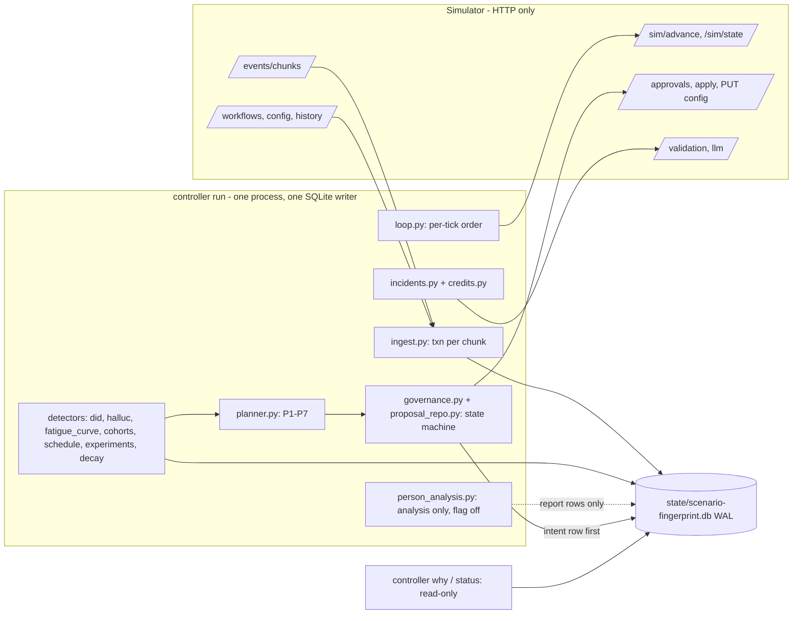

# Outcome-First Agent Loop — Submission

**Name:** Naman Rana · **Date:** 2026-11-07 · **Hours actually spent (be honest):** the work was done with parallel AI agents, so wall-clock and effort differ. Wall-clock span of the repository: 2026-11-06 00:50 to 2026-11-07 05:53 IST, about 29 h from the first commit to the last one before this commit (`git log`). Agent effort: about 33 h, an AI estimate from the git history with compressed commit times, not a stopwatch (`docs/TIMELOG.md`). **Human hours: <candidate to confirm>** · **Language / storage:** Python 3.13, SQLite (WAL)

> Every number below comes from a file in `reports/`, from `controller/settings.py` or `docs/THRESHOLDS.md`, or from a command run against a state database in `state/`; the source is named next to it.

---

## 0. TL;DR
- A single-process controller (`python -m controller run`, wrapped by `run.sh`) talks to the simulator only over HTTP. It ingests events into SQLite, partitions leads into cohorts, sets per-cohort call times, runs welcome x voice experiments with promotion, decay and rollback, fixes bad caller IDs and hallucinating prompts, and changes config only through the governance API.
- Results vs a no-op baseline (`reports/public_01.md`, `reports/public_02.md`): public_01 conclusion rate +9.4%, pickup +6.8%, engagement +1.9%, 22 changes (15 neutral, 7 beneficial, 0 harmful); public_02 +22.7%, +19.4%, +1.2%, 23 changes (15 neutral, 8 beneficial, 0 harmful), prompt incident fixed in 135 min. `lapsed`, `apply_conflicts`, `auto_apply_rejected` are 0 in both.
- Crash-safe and deterministic: 6 named fault points injected 11 times plus 10 random hard kills on public_02, 22 restarts, all invariants pass and the credits ledger reconciles (`reports/crash_test.log`); two concurrent public_01 runs with random hash seeds are row-for-row identical (`reports/determinism.md`). False-winner rate under the null: 1.0% over 800 simulated runs (`reports/mc_null.md`).
- Scale (`reports/public_03_load.md`, measured on an 8-core Windows laptop with the simulator co-located, not on a 4 vCPU / 8 GB Linux box): 12 workflows, 840k events per sim day, 380 to 504 s of wall per sim day for days 1-4, but Day 0 took 739 s (over 10 min, history ingest); 5,382 events/s ingest. First thing to break at 10x: SQLite commit and checkpoint in ingest.
- Not built: per-person call-time deployment (analysis only, flag off), tenant-fair allocation, prompt experiments outside incidents. Known limits: a decaying winner can stay live (on public_01 the decaying W3 arm held about 20% share through D6 because its last-24h z never fell below -1; on public_02 it was gone by D7), and `bad_default` has one change graded harmful (sections 11, 13).

## 1. Assumptions
1. **A1** The controller knows only what the HTTP API returns. Sim code was read to learn the contract (validation, grading), never imported by `controller/`, and no hidden-truth numbers are constants.
2. **A2** IST throughout; "Day 3 14:00" = sim minute 3*1440+840 (Day 0 = 2027-01-04, `settings.EPOCH_DATE`).
3. **A3** `*_max_drop: 0.02` is an absolute 2-point drop in the guardrail rate versus the concurrent control (or the pre-change baseline if there is none).
4. **A4** "Who approved" = the workflow's policy approver, identified by `approval_id` and the sim's `decided_at`; the simulator exposes no personal names. `why` says exactly that.
5. **A5** `max_shift` limits the speed of change: at most one auto-apply step per workflow per hour (`AUTO_APPLY_MIN_GAP_MINUTES = 60`), per tick in incident mode (`AUTO_APPLY_INCIDENT_GAP_MINUTES = 15`); steps are never chained within a tick.
6. **A6** Supervisor edits are legitimate and never silently reverted; a revert is proposed through the approver, naming the edit and the evidence.
7. **A7** Anita's limits (<= 2 requests/day, none before 11:00) are a soft preference on top of policy, keyed to the workflow id `ks_cancel` in `settings.SOFT_CAPS`, so they apply to no other workflow (a hidden Kestrel workflow with another id would not get them). The cap is ignored, with a logged `soft_cap_ignored` decision, when approver hours make it unsatisfiable; incidents may use the reserved slot.
8. **A8** Hidden scenarios may change options, policies, incidents, prompts and history length (including 0); everything is read from `GET /workflows` at runtime and each capability has a cold-start rule.
9. **A9** Priors, tunable and documented in `docs/THRESHOLDS.md`: `DID_H_FLOOR = 0.25` (worst plausible health of an untested DID, only used by the probe cap), `DID_PROBE_BASE_STEP = 0.015`, `DID_FLAG_MIN_DROP = 0.12`, `PERSON_PRIOR_STRENGTH = 20`.
10. **A10** Per-look significance levels are tighter than the spec's p < 0.001 because tests re-run every tick: `DID_FLAG_P = 1e-5`, `HALLUC_P = 1e-4`, `HALLUC_P_DRIFT = 1e-5`.
11. **A11** An allocation move below `DID_MIN_TV = 0.005` is not auto-applied, and below `DID_MIN_TV_APPROVAL = 0.03` it is not worth an approval slot.
12. **A12** An applied proposal is monitored for `MONITOR_MINUTES = 1440` and then closed; "closed" ends our monitoring window, it does not certify the change.
13. **A13** Credits: reserve per workflow `min(CREDIT_RESERVE_PER_WORKFLOW = 25, credits_initial / (2 W))` for incidents (W = number of workflows, so at most half the starting balance is held back); one incident spends at most `INCIDENT_CREDIT_CAP = 25`; Day-0 validation of each live prompt at n = 300 (3 credits).
14. **A14** A simulator that restarts is a new world: the DB is keyed by scenario plus the fingerprint of the first history chunk (`world_id.py`).
15. **A15** A supervisor version superseded within one advance cannot be recovered (the API returns no bodies); we mirror bodies after every `config_changed` event and accept the gap.
16. **A16** Welcome and voice are tested only on engagement-primary workflows; hour weights act only per cohort (a single default table does nothing under fixed hourly capacity, `docs/CONTEXT.md` section 3).
17. **A17** A caller-ID allocation last set by a supervisor is treated as owned: no rebalance or spreading over it; only evacuation of a flagged DID, through an approval that names the supervisor's edit (`controller/detectors/did_owner.py`).

## 2. Scope decisions
| # | Capability | Built / Partial / Cut | Why | What it would take to finish |
|---|---|---|---|---|
| C1 | Ingestion at load scale | Built | Spine. One txn per chunk, `event_id` primary key; 5,382 events/s on public_03 (`reports/public_03_load.md`) | Stream chunks (peak RSS 1.42 GB), batch commits, higher `wal_autocheckpoint` (section 8) |
| C2 | One shared cohort object | Built | Data-driven partition on one feature or a pair, self-checked against the sim's `cohort_id` on every call | Cohorts beyond the single-pass partition (re-partition during a run is not built) |
| C3 | History bootstrap | Built | Baselines, fatigue curve, flag baselines; cold start recomputes daily | Cold start exercised in unit tests only |
| C4a | Per-cohort call time | Built | Uses history only; schedule-only changes grade neutral | A concurrent control for the before/after check |
| C4b | Per-person call time | Cut (analysis only, flag off) | Eligible persons have at least 4 dials; the posterior is about 90% cohort prior (data weight 9.0 to 10.4%), selection effect, biased holdout (`reports/person_analysis.md`) | A per-person mechanism that does not compete for hourly capacity |
| C5 | Caller-ID health | Built | Biggest pickup lever; the public_02 and kyc_flag incidents | Production weekly re-probe of flagged DIDs |
| C6 | Welcome x voice experiments | Built | Main engagement lever; OBF + Holm + clustered SE | Per-cohort deployment of group winners is wired but rarely reached |
| C7 | Promotion, decay, rollback | Built | Two-stage promotion, sequential decay test, CUSUM, holdout | Decay faster than about 3 days is not separable from noise (section 5) |
| C8 | Hallucination incidents | Built | MTTR is graded: 135 min on public_02, 285 min on kyc_flag | `suggest-fixes` path is implemented but unexercised (0 LLM calls everywhere) |
| C9 | Governance client + planner | Built | Every change goes through it | Cross-workflow coordination |
| C10 | Impact, affected leads, dry run | Built (simple, honest) | `dryrun.py` replays 2-3 days of the cube; unobserved arms labelled `no_evidence` | Honest CI for schedule changes |
| C11 | Supervisor view | Built | `controller view` and read-only `controller ui`, never started by `run.sh` | Authentication, alert routing |
| C12 | Audit store | Built | `why --at / --from --to / --lead` (section 10) | Per-person view |
| C13 | Crash recovery, demonstrated | Built | 6 named fault points injected 11 times + 10 random kills (section 9) | Linux box, public_03 kill run |
| C14 | Loop observability | Partial | `metrics`, `tick_phases`, `status`, alert rules; no pager | Pager integration |
| C15 | Fair allocation across tenants | Cut | Budgets are per workflow already; matters at hundreds of tenants | Global coordinator for credits and approver attention |
| C16 | Prompt experiments outside incidents | Cut | Prompts are never in a public `allowed_dims`, every trial would be customer-facing and cost credits; prompts change only through the incident path (known-good revert, sibling check) | A prompt-level experiment design with its own guardrail and credit budget |

**Principle:** spine first (ingest, governance, audit, crash safety), then the levers with the most defensible lift per approval spent (caller-ID health, hallucination fixes, cohort call times, experiments), then reach. Everything optional sits behind a flag in `settings.py`; the one that did not earn its keep (`ENABLE_PERSON_ANALYSIS`) is off.

## 3. Stakeholders
Checked against the workflow policies in `docs/CONTEXT.md` section 3. Each reply is at most 120 words (counted).

### 01 Sales (Nikhil)
- **Accepted:** batching (planner P1: one in-flight approval per workflow, one `daily_bundle` per sim day); lift reported per KPI, never blended (R4).
- **Pushed back:** a blended score; "winning by lunch, live by evening" (minimum sample, sequential boundaries, approver latency 20-480 min, nw_kyc cannot change mid-campaign); rolling P4 out everywhere.
- **Wrong against policy:** ks_cancel auto-apply covers only schedule, caller_id, welcome and voice at max_shift 0.2 (no prompt, no cohorts); nw_kyc has `auto_apply.enabled: false`; P4 is not an option on nw_kyc.
- **Reply:** Nikhil, thanks. Pickup and engagement are reported separately per workflow; there is no blended score. Routine requests are batched, one daily bundle per workflow. "Winning by lunch, live by evening" cannot be promised: a winner needs a minimum sample and sequential test boundaries, and approvals take 20 to 480 minutes (20 to 120 for Kestrel) in working hours. Two claims do not match the policies: Kestrel's auto-apply covers only schedule, caller ID, welcome and voice, and Northwind's nw_kyc has auto-apply off. We will not roll P4 out: it is not an option on nw_kyc, and our Day-0 validation of P4 on ks_cancel passed 0.955 (9 failures in 200), below the 0.97 bar. Another account's demo is no evidence.

### 02 Compliance (Meera, Northwind)
- **Accepted:** named approval for customer-facing changes (welcome/voice/prompt/cohort changes go through the approver with evidence; the one exception is a risk-reducing harm-stop or rollback of welcome/voice where policy allows auto-apply, section 6); per-customer "why did they hear X" (`why --lead`); no night-time requests (`fatigue.filing_window_ok`); weekly summary of operational auto-applies (`view --weekly`).
- **Pushed back:** nothing.
- **Wrong against policy:** timing and caller-ID rotation are covered by auto-apply on nw_renewal, not on nw_kyc. The sim exposes no approver names (A4).
- **Reply:** Meera, thank you. Customer-facing changes are approved first, with their evidence, except risk-reducing harm-stops and rollbacks of welcome or voice, which auto-apply only where policy allows (Kestrel welcome/voice; never on Northwind) and are listed under "changed today". Requests are never filed at night. `controller why --lead <id>` shows, per customer, each call's welcome, voice, caller ID and prompt, and the decision and approval behind them. A weekly list of operational auto-applies is available. Correction: timing and caller-ID rotation are auto-applied on nw_renewal, not on nw_kyc, where every caller-ID change goes to your approver. We record the approval id and decision time, not the approver's name.

### 03 Platform/SRE (Kabir)
- **Accepted:** kill/restart test (`scripts/crash_test.py`); idempotency (write-ahead proposal ids); health without logs (`status`); under 10 min per sim day; a 10x analysis.
- **Pushed back:** Postgres for the assignment; SQLite is one embedded file and the schema ports (partition `calls` and `cube` by day, shard by workflow).
- **Pushed back:** Postgres for the assignment. SQLite is one embedded file and the schema ports (partition `calls` and `cube` by day, shard by workflow); Postgres is the production plan, not something rejected.
- **Reply:** Kabir, the kill/restart test exists (`scripts/crash_test.py`): 6 named fault points injected 11 times plus 10 random hard kills on public_02, 22 restarts, all invariants pass (`reports/crash_test.log`); proposal ids are written before sending, so retries are idempotent. Scale was measured on an 8-core Windows laptop with the simulator co-located, not your 4 vCPU / 8 GB Linux target: public_03 days took 380 to 504 s, but Day 0 took 739 s, over 10 minutes. The SQLite file must sit on a persistent volume: losing it loses the decisions audit trail (re-ingest rebuilds data, not decisions). At 2 a.m. the on-call follows `docs/RUNBOOK.md`. Postgres is the production plan.

### 04 Ops supervisor (Anita, Kestrel)
- **Accepted:** never silently undo her edits (A6); soft cap of 2 requests/day and none before 11:00 (applied to workflow `ks_cancel` only, A7); engagement is verified after any prompt change, but a safer-yet-stricter prompt is not blocked up front (a switch that costs engagement is rolled back only after it is applied, section 11); one screen (`view`).
- **Pushed back:** one reserved incident slot beyond her 2/day; operational DID and schedule changes happen without advance notice and appear under "changed today".
- **Wrong / mismatched:** she wants notice before changes, Sales claims Kestrel wants everything automatic; most customer-facing changes reach the policy approver first, so a person is told, but risk-reducing harm-stops and rollbacks of welcome/voice auto-apply on Kestrel and are shown only under "changed today". The memo assumes she is the approver; the sim exposes no names (A4).
- **Reply:** Anita, your edits are never overwritten silently. When your Day 3 prompt edit raised hallucinations, we filed one approval request naming your edit and the numbers, applied it once approved, and verified engagement afterwards; the fix landed 135 minutes after your edit. Customer-facing changes are approved first, except risk-reducing harm-stops and rollbacks of welcome or voice, which auto-apply only where policy allows (Kestrel welcome/voice; never Northwind) and are listed under "changed today". Your two-a-day, not-before-11:00 preference is applied to ks_cancel only, and is ignored, with a logged decision, if approver hours make it impossible. One extra slot is kept for incidents.

### 05 Product (Tara)
- **Accepted:** separate KPIs; one shared cohort object (documented minimum n and window); every proposal carries summary, rationale, impact, affected leads and dry run; expired = rejection, re-planned with fresh data; only observed arms count; per-workflow promotion.
- **Pushed back:** the three P0s cannot all ship at full depth. Per-cohort call time ships; per-person call time is analysis only, with numbers (section 12). Experiments run at the workflow level plus at most 2 pre-registered groups, not per cohort.
- **Wrong against policy:** nothing factual. Prompt changes have no historical dry run and are labelled validation-only.
- **Reply:** Tara, KPIs stay separate everywhere, and one shared cohort object feeds call times and experiments. Each request carries a summary, rationale, impact score, affected leads and a dry run built from observed data; unobserved arms read "no evidence". Expired requests are rejections, re-planned on fresh data. The minimum cohort size costs you fewer per-cohort verdicts; it buys a low false-winner rate (1.0% under the null, `reports/mc_null.md`). Experiments run at workflow level plus at most two groups, not per cohort. Per-person call time is analysis only: the data weight is about 10%, and a no-effect control qualifies 75 to 90% as many people at the same apparent lift. Prompt changes are validation-only.

### 06 CTO (Aryamann)
- **Accepted:** explainable over impressive (deterministic rules, every decision a `decisions` row); credits only where they change a decision (prompt validation and sibling-prompt safety checks); the scale envelope (section 8); a written "no" for each cut (sections 2, 12); on-call docs (`docs/RUNBOOK.md`).
- **Pushed back:** nothing.
- **Wrong against policy:** he warns the memos contain errors; confirmed, listed above.
- **Reply:** Aryamann, you were right that the memos disagree with the policies; the corrections are in the Sales, Compliance and Ops replies. Every change is a deterministic rule and a `decisions` row that `controller why` replays. Credits go to prompt validation and sibling-prompt safety checks, which we do spend proactively at Day 0 (24 to 30 of 200 per scenario), never to speculative fix generation (0 LLM fix calls). We cannot promise zero transient harm: exposure is capped by a 7.5% entry, a 20% ramp and a harm-stop at z <= -3, and `bad_default` shows one harmful bundle. Cuts are written down (sections 2, 12). Scale and weaknesses: sections 8 and 13.

## 4. Architecture



Per tick (`loop.py`): reconcile in-flight approvals -> ingest new chunks and mirror configs -> apply approved changes (only if `apply_by` has not passed and the base version is current; otherwise mark LAPSED/STALE locally and never call `/apply`) -> detectors -> planner and submit -> per-person analysis (flag off, never raises) -> metrics row -> advance (15 min; 60 min when idle outside every dialling and approver window). Every detector, producer and apply-time veto runs in its own exception guard: a failure is logged, raises one alert and one decision row per sim day, and the rest of the tick continues. A crashed veto fails safe (a routine change is retried for up to `VETO_CRASH_MAX_RETRIES = 3` ticks, then withheld) but never blocks harm-stop, rollback, evacuation, hallucination or revert kinds (`desired.py`).

**State (SQLite WAL, `controller/schema.sql`):** `ingest_cursor`, `leads`, `calls` (event_id primary key), `cube` aggregates, `config_versions` (actor, proposal link, mirrored body), `proposals` + `proposal_events` (full state history), `decisions` (every detect/propose/apply with an inputs snapshot), `incidents`, `validation_runs` + `llm_calls` (credit ledger), `jobs`, `detector_state`, `alerts`, `metrics`, `meta` (world fingerprint).

**Restart behaviour:** open the DB for this world (a changed fingerprint or regressed sim opens a new one), re-read `/sim/state`, reconcile governance (INTENT proposals are looked up in `GET /approvals` by proposal id and resent verbatim if absent; APPROVED ones are applied if still valid; auto INTENTs are matched in `config/history`), re-ingest after the cursor (re-reading a chunk changes nothing) and continue. A world regression noticed mid-run (the simulator restarted or went backwards) makes the controller exit 4 and `run.sh` restart it against a new DB. After a state loss `plan_seq` is seeded from the simulator's approvals and config history, so new proposal ids cannot collide. A lost approval (an `/apply` that never reached the sim) stays APPROVED and is retried after the pre-checks. `run.sh` checks the controller's dependencies, falls back to `pip install --user` and then to a virtualenv (each with a pip timeout and one retry), restarts a crashed controller (cap 20, reset whenever the simulation moved forward during the failed run), gives a restarted controller a 120 s startup wait, and exits 0 only when the controller exits 0, which happens only once the sim reports finished.

## 5. The learning loop
All parameters are in `controller/settings.py` with their derivation in `docs/THRESHOLDS.md`; the decision rule lives in `controller/exp_rules.py` and the Monte Carlo (`scripts/mc_null.py`) runs that same code.

**Cohorts.** At Day 0 `cohorts.py` scores every single feature and every pair of the four lead features by how much a separate **hour-of-day pickup profile** per group beats one pooled profile (a separable group + hour model is the null, so level differences count for nothing: only profiles that per-cohort hour tables can exploit). A partition must beat the pooled profile at one-sided p < 1e-4 (`COHORT_MIN_Z = 3.72`, which is 1e-3 over 10 candidates) and a pair must beat the best single feature by 2 z, so noise does not fragment traffic. Groups are disjoint (a partition, so first-match order cannot matter); a group below n_min = 100 dials per in-window hour (`COHORT_MIN_DIALS_PER_HOUR`, se_rel 15% per cohort-hour) falls into `default`; at most 20. The cost of that minimum size is fewer per-cohort verdicts and schedules (small groups share the default table); the benefit is a low false-winner rate, 1.0% under the null (`reports/mc_null.md`). On public_02 ks_cancel the result is 4 cohorts by `age_band`. Defining cohorts needs approval (never in a public `allowed_dims`), so it is part of the Day-0 bundle. Every call's `cohort_id` is checked against our own evaluation of that event's config version (`cohort_mismatch` pages).

**Per-cohort schedule (C4a).** Per cohort and hour, an observed/expected pickup multiplier from the last 14 days, controlling for attempt number and campaign day, shrunk by empirical Bayes (tables collapse to the pooled profile when cohorts do not differ). Weights are mean 1, clipped to 0.3-3, every in-window hour present. A dry run re-weights recent dials under fixed hourly capacity and blocks the change if the estimated engagement drop exceeds the workflow guardrail; a refresh needs an estimated gain of at least 0.5%. After apply, hour-mix-adjusted pickup is compared before and after and the schedule is rolled back at a guardrail-sized fall with p < 0.05 (the check has no concurrent control and says so; public_02 nw_renewal v4 is such a rollback, `why` section 10).

**Experiments (welcome x voice, engagement-primary workflows).** Each dial is randomised independently, so the design is factorial and we analyse main effects per dim; interactions are reported from the 2-way table, not acted on. Entry: challengers start at **7.5%** each (at most 22.5% per dim). **Ramp:** after at least 1 day and 100 connects an arm with a non-negative point estimate goes to 20%, control never below 40%; a bad recent window blocks the ramp (last-24 h z <= -1 on at least 50 recent connects, `EXP_RECENT_MIN_CONNECTS`), at the look and again at apply, because a 7.5% arm sees too few connects a day for the 100-connect rule alone. **Drop:** whole-experiment z <= -1.5 below 300 connects, <= -1 above, and a ramped arm also at last-24 h z <= -1.5. At apply time a drop is vetoed only if the arm clearly recovered (hysteresis: a ramped arm's last-24 h z above -1, or cumulative z more than 0.5 above the drop bound), so a noisy window cannot flip a drop back and forth. **Harm-stop** every 4 h: z <= -3 with >= 150 connects removes the arm at once. Unit: the connected call with **per-lead clustered (sandwich) standard errors**, Mantel-Haenszel pooled over day x share-regime strata so ramps and base-rate drift do not confound. **Winner:** one-sided test at looks when information reaches 0.25/0.5/0.75/1 of the design value (10% lift, 80% power), **Lan-DeMets O'Brien-Fleming** boundaries, **Holm** across the arms of a dim, familywise 0.05 per workflow split over the two dims (workflow-level 0.02 plus two pre-registered traffic groups at 0.0025 each, per dim). Promotion also needs point lift >= 3%, the **recent-24 h one-sided 95% lower bound > 0** (never promote a variant that has begun to decay), and a **non-inferiority guardrail** on pickup (clustered difference, upper bound of the drop under the policy's `pickup_rate_max_drop`). Exploration vs exploitation: a fixed-horizon sequential design with a conservative ramp, not a bandit (section 12).

**Two-stage promotion and holdout.** Stage 1: winner 50% / old control 50% (a half-power concurrent control for a variant that never carried real traffic). Stage 2: 90% / 10% holdout only after >= 24 h at stage 1, a positive recent lower bound and a positive concurrent contrast. Both stages are customer-facing and go through approval. Before `/apply` of any approved ramp, drop or promotion stage an **apply-time veto** re-checks the evidence (recent-24 h one-sided 80% lower bound > 0 for promotions); a withheld change is never sent to `/apply`, so no lapse is logged. A withheld or approver-rejected drop puts the arm back into the experiment instead of orphaning it, and every tick `exp_reconcile.py` compares the intended split with the live config and re-files a change that never landed. A bundle that carries a risk-reducing harm-stop or rollback is never withheld because another dimension's part went stale (that part is applied and logged as `experiment_stale_part_applied`).

**Decay and rollback.** A sequential winner-vs-control test (level 0.10 per epoch, OBF, epochs restart when information reaches that of a -15% effect at 80% power) plus a **CUSUM** of the winner's composition-adjusted engagement (blocks of 150 connects, k = 0.5, h = 3) that needs the holdout's recent direction to agree. A rollback is risk-reducing: auto-apply where the dim is allowed, else the second-to-last approval slot, superseding any routine request in flight. Measured limit (`reports/mc_null.md`, 250 runs per row): a promoted decaying winner (+15% falling to -10% over 2 days) was rolled back in 24.0% of runs against 24.4% promoted in the first row (one run of 250 was not rolled back within 16 days) and in every promoted run in the other four rows (for example 20.0% promoted, 20.0% rolled back), at a median of 11-14 four-hour ticks after stage 1; its share is at most 0.1 two days after onset in only 2.0-16.4% of runs. A decay faster than about 3 days is not separable from noise at a 20% share.

**Decay limit seen in a graded run.** On public_01 the decaying nw_renewal W3 arm kept about 0.20 share through D6 and fell to 0.086 on D7 (`reports/public_01.md`); on public_02 it was 0.033 on D6 and 0 from D7 (`reports/public_02.md`). The diagnosis during the floor fixes found that W3's last-24 h z on public_01 never fell below -1 (+1.07, -0.11, +0.54, +0.87 on days 3-6; these four values are from that diagnosis and are not in a committed report), so no rule that also protects null arms from false drops would have removed it. A bug that orphaned a withheld drop was found and fixed; the shares above are after the fix.

**False-winner rate (`reports/mc_null.md`, 800 null runs):** 1.0% any-arm false promotion (target <= 5%); 0.2% on arm A, 0.8% on B. A scenario has 4 experiments (2 workflows x 2 dims), so at least one false promotion per scenario is about 4x that. Power: a +10% arm is promoted in 34% of runs, +15% in 63%, median day 4.8-5.8. Stratified and unstratified contrasts false-promote at the same rate (1.3% each) at +-5% drift.

**Caller ID (C5).** A monotone fatigue curve (pickup ratio vs trailing decayed dial volume, decay window chosen from `DID_FATIGUE_TAU_GRID_DAYS` by fit; nothing taken from the sim). Flagged DID: a step drop vs peers (or vs its own 48 h history when it has no peers) at `DID_FLAG_P = 1e-5`, >= 150 dials a side, relative drop >= 12%, holding for 2 evaluations. Probes of new DIDs at share `s <= 0.015 h/(h - 0.25)` (about 2%), so the worst-case DID-health step stays above the -2% harmful line; weak bases need two distinct days. Evacuation in steps bounded by `max_shift`.

**Hallucination.** A flag-rate test per prompt segment against the last known-good prompt (Day-0 validation, n = 300) with an absolute ceiling of `1 - min_validation_pass_rate` that is never set below the known-good prompt's own measured flag rate (Wilson upper bound), so detector false positives in the baseline do not open incidents; a supervisor edit starts a new segment at once. Fix: revert to the workflow's own known-good prompt using its Day-0 validation as evidence (no new credits); a known-good prompt whose stored validation is borderline (below the bar by at most 2 standard errors, n under 300) is revalidated once at a larger sample before it is used. **Sibling-prompt safety check:** at Day 0 up to 3 sibling catalogue prompts are validated (2 credits each); the live prompt is switched only if a sibling is clearly safer (one-sided 95% Wilson bounds) and the live failure bound is at least half the policy tolerance; after apply the switch is verified and rolled back on failure.

**Call time and caller ID, per-cohort vs per-person.** Call time is per cohort from history, no exploration. Per-person is analysis only (section 12). Caller ID explores by capped probes, never by random assignment.

**Guardrail KPI.** Experiments: the non-inferiority test above. Schedule: the dry-run engagement cap plus the before/after check. Reporting caveat: engaged/connected falls a little whenever pickup rises (repeat connects are by construction people who did not engage the first time); on null_01 the dip was -0.5 to -1.2 pp, z -0.7 to -1.1 per workflow, first-connect engagement unchanged (`reports/guardrail_analysis.md`, run on an earlier null_01 run; the final null_01 grade is -1.3% overall, `reports/dev/null_01.md`). Experiment tests compare arms within the same period, so they are not exposed; day-vs-baseline KPI views are.

## 6. Governance
**State machine** (`proposal_repo.py`): `DRAFT -> INTENT -> PENDING -> APPROVED -> APPLIED -> MONITORING -> CLOSED`; auto path `INTENT -> AUTO_APPLIED -> MONITORING -> CLOSED`; branches `REJECTED` (reasons stored, planner re-plans), `EXPIRED` (treated as a rejection, new id on fresh data), `STALE` (base changed: re-plan, re-read any supervisor edit, never call `/apply`), `LAPSED` (`apply_by` passed: should be impossible, alerts), `SUPERSEDED`, `SUBMIT_FAILED`. The proposal id `workflow:plan_seq:kind` and the full body are written before anything is sent.

**Batching and timing.** One in-flight approval per workflow (P1); a `daily_bundle` once per sim day carries every wanted change (cohorts, schedules, experiment ramp/drop, promotion stages) in one request. Requests are filed only inside approver hours and only if the probability that the decision lands before `expires_at` is high enough: `fatigue.decision_probability` (latency is uniform on the policy range) must be at least 0.9 for routine requests (`FILE_MIN_P_ROUTINE`) and at least 0.5 for incident and severe ones (`FILE_MIN_P_URGENT`). This replaces the earlier worst-case rule, which starved short-TTL policies; on the public policies the two agree. The rolling 24 h ledger has three **slot tiers**: the **last slot is reserved for safety incidents only** (hallucination fix, flagged-DID evacuation where auto-apply is off); harm-stop and rollback may use the **second-to-last**; routine bundles get **max(1, max - 2)**. A rollback therefore never blocks a safety fix, and a collision merges into one superseding proposal. With a budget of 1 request per 24 h, routine and severe requests share the single slot (otherwise the controller could never act except for incidents); the trade-off, documented in `docs/THRESHOLDS.md`, is that an incident arriving right after a routine filing waits up to 24 h. The soft cap of 2/day and not-before-11:00 applies to `ks_cancel` only. A failed submit backs off for `SUBMIT_FAILED_BACKOFF_MIN` = 240 sim minutes (30 for an incident on the approval route).

**Supersede.** A higher-priority need while something is in flight produces one proposal that contains the new change plus every still-wanted change from the in-flight one, using the reserved slot; whichever is approved first and still valid is applied and the other is marked `SUPERSEDED` and never applied. Example: public_02 ks_cancel v9 is a hallucination fix that also carries the pending voice ramp (section 10).

**Auto-apply, and when we voluntarily do not.** Auto-apply only for operational changes (caller ID, schedule) and risk-reducing ones (harm-stop, rollback) where the policy allows the dim and the per-cohort-per-dim TV is within `max_shift`. Customer-facing changes are approved first (welcome and voice entry, ramp, drop and promotion; prompts; cohorts, which are never auto-applied), even where welcome and voice could be auto-applied, because a named approver is what Compliance asked for. The exception: a risk-reducing harm-stop or rollback of welcome or voice auto-applies where the policy allows it (Kestrel's ks_cancel; never on Northwind), and it is listed under "changed today" on the one-screen view. nw_kyc has auto-apply off, so its caller-ID changes are approvals. The approver is the workflow's policy approver; we do not assume who that is (A4).

**Local validation.** Every field the approver checks softly (empty summary, diff, rationale or dry run, non-integer `affected_leads`, impact outside [0, 1], missing prompt evidence, fatigue) and the auto-apply policy are checked before sending (`governance.py`), so 4xx and graded 403s should not occur: `auto_apply_rejected` is 0 in every report.

**Impact, affected leads, dry run, honesty.** `impact_score = clip(lower-bound relative lift on the primary KPI x share of traffic affected / 0.10, 0, 1)`; safety fixes use excess hallucination rate over the policy tolerance. `affected_leads` counts active in-cadence leads whose effective distribution changes. The dry run replays 2-3 days of the cube at observed per-arm rates under the new weights with a CI; unobserved arms are `no_evidence`; prompt changes are `validation-only`. It is an observational replay, not a causal estimate.

**Reconciliation and crash safety.** At startup and every tick, `GET /approvals` and `config/history` are matched by proposal id: an INTENT is resent verbatim only if absent; an APPROVED proposal is applied only if `apply_by` has not passed and the base version is current; a supervisor edit between propose and apply makes it STALE; an `/apply` that never reached the sim leaves the proposal APPROVED and it is retried after the same pre-checks. Credit-costing calls have their own crash point and ledger reconciliation (section 9).

**Supervisor edits mid-experiment.** The affected dim is marked interrupted; earlier data stays valid for arms that ran; the edit is never re-imposed over. After `EXP_SUPERVISOR_COOLDOWN_MINUTES` the supervisor's choice is the new control and the next `change_summary` says so; arms that were behind the new control are not re-entered. On public_02 nw_renewal the supervisor set voice to V2 only (v11 at Day 5 15:00): the controller did not revert it. A supervisor's caller-ID allocation is likewise owned (A17): it is never rebalanced, only evacuated of a flagged DID through an approval that names the edit.

## 7. Incidents
**Thresholds** (`controller/settings.py`, derivations in `docs/THRESHOLDS.md`): flagged DID `DID_FLAG_P = 1e-5` per look with 1/2/3/6 h windows, >= 150 dials a side, drop >= 12%, 2 consecutive evaluations; hallucination `HALLUC_P = 1e-4` (fresh segment) and `1e-5` (drift) with >= 200 connects. The levels are tight on purpose because tests repeat every tick.

**False positives observed** (the `incidents` table of each final run's state database; `state/` is git-ignored, so this count is not in a committed report): public_01 0 incidents; public_02 2 (both real, the graded D2 flag and the supervisor prompt edit); kyc_flag 2 (both real); bad_default 0; null_01 **1 flagged-DID incident on nw_kyc at Day 0 13:00 with no graded incident in that scenario (`reports/dev/null_01.md`: Incidents `[]`), which is one false positive in five runs.** It was handled by evacuation steps and no applied change was graded harmful. A calibrated rate is not claimed; 5 runs is too few.

**Choosing a fix:** revert to the workflow's own known-good prompt (its Day-0 validation is the evidence, so no new credits); only if none exists, `suggest-fixes` plus validation ranked by lowest failure upper bound (implemented, 0 LLM calls in every run). **Credit spend** (of 200 per scenario; `reports/public_01.md`, `reports/public_02.md`, `reports/dev/*.md`): public_01 24 credits (10 validation runs), public_02 26 (11), kyc_flag 29 (12), null_01 30 (12), bad_default 30 (12), 0 LLM fix calls. These are Day-0 validations of live prompts and the sibling-prompt safety checks, spent proactively rather than only when an incident fires.

**Verify after apply:** the new prompt's flag rate must be non-inferior to baseline (margin a third of the policy tolerance, between 400 and 1,500 connects, waiting if unresolved) and engagement inside the guardrail, else the next candidate; a DID incident closes when the flagged DID's observed share is under 0.5%.

**Timeline, public_02 ks_cancel Day 2 to Day 4**, assembled from the `why` outputs of the graded run in `reports/audit_examples.md` (`state/final2`; experiment looks omitted):
```
  Day 2 11:45  did_flagged: FLAGGED D2: pickup ratio vs peers fell 69% (p=3.6e-07, 244 dials in 2h vs 1916 in the reference); incident mode
  Day 2 12:00  proposal_auto_applied: ks_cancel:7:did_evacuation -> config v7 (controller_auto, caller_id): D2 14.3% -> 0.0%
  Day 2 23:00  incident_closed: D2 evacuated: observed share 0.00% over the trailing window, config v7 share 0 in every key
  Day 3 11:30  config_observed: v8 by supervisor changed ['prompt_version']
  Day 3 11:45  incident_opened: halluc  (bad_prompt_day0: P2 flags 5.5% vs failed Day-0 validation, n=200)
  Day 3 11:45  proposal_pending: ks_cancel:9:halluc_fix            (revert P2 to P1, validation val_00001 pass 0.987)
  Day 3 13:45  proposal_approved + applied -> v9 (controller_approved; approver decided 13:26)
  Day 3 17:30  incident_verified: P1: flags 1.23%, engagement ok; incident_closed
  Day 4 11:45  did_flag_expired: D2 re-probed at the re-probe cap (v10, controller_auto)
```
The grader reports `mttr_minutes: 135`, `fixed_by: controller_approved`, flagged-DID share by day 0.081 (Day 2), 0.0 (Day 3), at most 0.009 afterwards (`reports/public_02.md`). The 135 minutes are the supervisor edit (11:30) to our apply (13:45); detection took 15 minutes and the approver decided at 13:26. On kyc_flag (a supervisor prompt edit on nw_renewal at Day 4 12:00) the grader's MTTR is 285 min with `fixed_by: controller_approved` (`reports/dev/kyc_flag.md`); I did not break that figure down further. Evacuating a flagged DID on single-DID nw_kyc is slow: kyc_flag's flagged-DID share was 0.984, 0.616, 0.333 and 0 over D3-D6 (about 3 days), because nw_kyc applies changes at the next campaign.

## 8. Scale
From `reports/public_03_load.md` (12 workflows, 840,000 events per sim day, 5 sim days run to the end). **Measured on a Windows 10 laptop with 8 cores, simulator and controller on the same machine, SQLite on local disk. It was not measured on the 4 vCPU / 8 GB Linux target.** The per-day wall times below include the simulator's own compute.

| Metric | Measured |
|---|---|
| Wall per sim day (incl. sim compute) | 380 / 422 / 499 / 504 s for days 1-4 (6.3 to 8.4 min, under the 10 min target). **Day 0 took 739 s (12.3 min, over 10 min)** because it carries the 6.4 min history ingest |
| Ingest | 5,382 events/s (4.20M events, 780 s inside ingest) |
| Controller time per tick | p50 1.74 s, p95 13.5 s, max 69.5 s (15 sim minutes per tick) |
| End-to-end decision lag | p50 1.7 s, p95 13.5 s, max 69.5 s (against 24 h apply windows) |
| Peak RSS | 1,422 MB (reached while ingesting the history chunks at start-up, never exceeded afterwards; steady-state RSS was not sampled separately) |
| DB | 892 MB after history, then about 120 MB per day (1.38 GB, 7.43M `calls` rows) |
| Outcome | rc 0, 70 changes applied (33 beneficial, 37 neutral, 0 harmful), `lapsed` 0, `apply_conflicts` 0, `auto_apply_rejected` 0, 100 of 400 credits |

Before the profile-driven fixes (cell-filter `EXISTS` instead of `IN (SELECT ...)`, cached completed-day arm counts, cached schedule strata) days 3 and 4 took 700 and 772 s, over the target; detector time halved (1,144 s to 570 s). On a 4 vCPU Linux box the sim and controller would compete for fewer cores, so these figures are not a guarantee there.

**What breaks first at 10x (about 8.4M events/day):** (1) SQLite commit and checkpoint of random index pages in ingest: about 85% of ingest time is inside `COMMIT` (every call row dirties a random page of `calls_lead`); ingest alone would be about 26 min per sim day; raising `wal_autocheckpoint` gave 23.8k events/s in a replay (deferred, not removed) and `json.loads` is not the limit (124k events/s per core); (2) per-tick detector queries over a `calls` table that stops fitting the page cache (about 14 GB per 5 days); (3) memory, because whole chunks are materialised (a 10x morning chunk is about 540 MB of text; stream it); (4) the simulator itself (90 to 190 s per day, not ours). **Partitioning:** shard by workflow (all state, approvals and DID pools are per workflow; only the credit pool is shared, so give each shard a reserved share plus a shared top-up), one process and one DB per shard of 2 to 4 workflows, each pre-filtering lines on `workflow_id` before parsing, batched commits across chunks and an explicit checkpoint on idle ticks; beyond that Postgres or a column store for `calls` with the same keys. The ingest-side changes were not applied, because they deserve their own crash-test run (`reports/public_03_load.md`).

## 9. Reliability
**Method** (`scripts/crash_test.py`, subprocess only): start `python -m sim serve` for public_02, run `python -m controller run` as a subprocess, and (a) for each fault point in `controller/faults.py` run with `CRASH_AT=<point>:<n>` until the process `os._exit`s (rc 137, no cleanup handlers), then restart; (b) 10 `Popen.kill()` hard kills after seeded random wall delays; (c) run to completion and check invariants over HTTP, the sim's grader and our store. The 6 fault points: `mid-ingest-txn`, `after-submit-before-record`, `after-apply-before-record`, `after-advance-before-ingest`, `after-credit-call-before-record` (a kill between a credit-costing call and its ledger row) and `before-apply-request` (between the `apply_intent` log and the `/apply` POST).

**Result** (`reports/crash_test.log`, Windows 10, Python 3.13, seed 7): the 6 named fault points were injected 11 times (all 11 fired), all 10 random kills were delivered mid-run, 22 restarts, controller finished rc 0 in 355 s and the sim reached `finished` (sim minute 14,400).
```
INVARIANT PASS: every named fault point fired -- fired=11 of 11
INVARIANT PASS: every controller_* config version maps to a unique proposal_id -- 22 versions checked; bad=[]
INVARIANT PASS: no duplicate applies in our store -- duplicates=[]
INVARIANT PASS: grade: lapsed 0, apply_conflicts 0, auto_apply_rejected 0
INVARIANT PASS: every proposal is terminal/consistent with GET /approvals; no approval lost -- 24 proposals, 13 approvals
INVARIANT PASS: ingest cursor monotonic across restarts and == sim last_event_id at the end -- final=324341 sim=324341
INVARIANT PASS: credits ledger reconciles: initial=200.0 sim_remaining=184.0 ledger=16.00 of which unrecorded-at-crash=5.00
INVARIANT PASS: experiments were active (experiment_* proposals exist for the kills to land on)
RESULT: ALL INVARIANTS PASS
```
**What state is lost:** nothing committed. An interrupted chunk transaction rolls back and the chunk is re-read; an advance that returned before the crash is found by re-reading `/sim/state`; caches are rebuilt from SQLite. A kill inside a credit call can leave the spend unrecorded; startup reconciles the ledger against the sim's `credits_remaining` (5 credits were found unrecorded in this run and are booked as such). **Not shown:** the Linux grading box, public_01 or public_03 under kills, and a SQLite file corrupted on disk (the runbook covers it: re-ingest from the simulator, losing our `decisions` rows and detector state). The SQLite file therefore has to live on a persistent volume: losing it loses the decisions audit trail, which re-ingest cannot rebuild.

**Idempotency keys:** `proposal_id = "{workflow}:{plan_seq}:{kind}"`, written with the full body before anything is sent; the sim rejects a duplicate id with 409 and we adopt the existing approval. After a state loss `plan_seq` is seeded from the sim's approvals and config history so ids do not collide. An INTENT row is matched against `GET /approvals` (or `config/history` for auto-applies) and resent verbatim only if absent. Ingest is idempotent on `event_id`.

**Simulator 4xx/5xx** (`controller/client.py`): 5xx and transport errors on reads retry with exponential backoff (`RETRY_ATTEMPTS = 5`, 0.5 s doubling to 8 s), then `SimUnavailable`. `POST /sim/advance` is never retried: on failure we poll `/sim/state` until `sim_minute` is stable across two reads (or raise `AdvanceNotApplied`; the loop gives up after 5). Mutating and credit-costing calls are attempted once; a transport or 5xx failure raises `OutcomeUnknown` and governance reconciles by lookup. 4xx are typed and never retried: 409 duplicate adopts the approval; 409 stale base is STALE and re-plans; 409 `not_approved` reconciles; 409 `finished` exits 0; 410 is LAPSED plus an alert; other 4xx on submit is `SUBMIT_FAILED` plus an alert and a backoff.

**Determinism (`reports/determinism.md`).** Final verification at commit c556fce: two clean concurrent public_01 runs with random `PYTHONHASHSEED`s are identical: `decisions` (2,545 rows), `proposals` (24), `config_versions` (25), `alerts` (3) and the grade JSON (14,139 bytes); the graded `run.sh` run (`state/final1`) matched run A. The check originally failed (first divergence at Day 1 15:15): the planner built allocation dicts in string-hash order and the simulator samples options in the dict's key order. After sorting keys everywhere (`configlib.normalise_weights`, `did_plan`, float sums over sets) the runs match.

## 10. Audit & observability
All modes read only our SQLite store (`--db FILE`, or the newest DB in `--state-dir`; `--json`). Real output from the graded run `state/final2` (public_02), copied from `reports/audit_examples.md` (more examples there, for public_01 too); long lines are cut:

`python -m controller why --db state/final2/public_02_incidents-afcb9425.db --workflow ks_cancel --at "Day 3 14:00"`:
```
why ks_cancel at Day 3 14:00
  active version v9 by controller_approved (observed Day 3 13:45, dims ["welcome_message", "voice", "prompt_version"])
  proposal ks_cancel:9:halluc_fix [approval] state=CLOSED base=v8 applied=v9 at Day 3 13:45
    summary: Revert P2 (set by supervisor Day 3 11:30) to P1: flags 5.5% vs failed Day-0 validation (n=200, p=0.0e+00);
             validation val_00001 pass 0.987; voice experiment: drop V3 (lift -11.3%, z -1.70, recent z -1.20); ...
    impact=1.0 affected_leads=3671
    approval apr_00008: APPROVED (decided_at Day 3 13:26, observed_at Day 3 13:45) by policy approver of ks_cancel; the sim exposes no approver names
    policy: approver hours [10, 19], latency [20, 120] min, ttl 12 h, max 4 requests/24h
  proposal lifecycle: DRAFT 11:45 -> INTENT -> PENDING -> APPROVED 13:45 -> apply_intent -> APPLIED 13:45 -> MONITORING 14:00 -> CLOSED Day 4 13:45
  evidence: Day 3 11:00 halluc_eval P1: flags 1.46% vs 1.37% ... Day 3 11:45 incident_opened (bad_prompt P2, edit by supervisor v8)
  post-apply monitoring:
    Day 3 14:00 experiment_applied: voice is live: V1 92.5%, V2 7.5%
    Day 3 17:30 incident_verified: P1: flags 1.23%, engagement ok
  superseded by v10 (controller_auto) at Day 4 11:45, proposal ks_cancel:10:did_probe: Probe/spread caller IDs within the safe probe cap ...
```
The impact score saturates at 1.0 for safety fixes (here `impact=1.0`, from the excess hallucination rate over the policy tolerance), so it does not distinguish how large a safety fix is.

`python -m controller why --db state/final2/public_02_incidents-afcb9425.db --lead ks_cancel:l00024079 --day 3` answers Compliance's per-customer question:
```
lead ks_cancel:l00024079 person ks_cancel:p0009326 workflow ks_cancel campaign ks_cancel:c0017 (created Day 2 08:00), day 3
  Day 3 13:56 attempt 1 welcome W1 voice V1 DID D1 prompt P1 cohort age_band=18-30 connected=False engaged=False
    allocation from config v9; prompt from config v9 active at the call time
  Day 3 19:50 attempt 2 welcome W1 voice V1 DID D3 prompt P1 cohort age_band=18-30 connected=False engaged=False
  decisions behind config v9:
    by controller_approved at Day 3 13:45 dims ["welcome_message", "voice", "prompt_version"]
    proposal ks_cancel:9:halluc_fix: Revert P2 (set by supervisor Day 3 11:30) to P1: ...
    approval apr_00008 APPROVED decided_at Day 3 13:26 observed_at Day 3 13:45 by policy approver of ks_cancel
```
(The allocation of a call comes from the campaign's version and the prompt from the version active at the call time, per `docs/CONTEXT.md` section 3.)

**Alerts we would page on** (rows in `alerts`, rules in `controller/alerts.py`; routing is not built): `ingest_stalled`, `apply_by_near`, `credits_low`, `sim_5xx`, `fatigue_rejection` and `http_403` (our accounting or pre-check is wrong), `cohort_mismatch`. **Digest only:** `judgement_rejection`, `starved_experiment`, `weak_base_did`, `kpi_drift`, `person_analysis_failed`, and the once-a-day `detector_failed` / `producer_failed` / `veto_failed` warnings. `docs/RUNBOOK.md` says what to do for each.

## 11. Results
Summary tables from `reports/public_01.md` and `reports/public_02.md` (the template's two files), plus the dev scenarios in `reports/dev/`. Every report is a no-op-baseline comparison from `python -m sim grade`.

| scenario | workflow | conclusion rate (delta) | pickup (delta) | engagement (delta) |
|---|---|---|---|---|
| public_01 | ks_cancel | 0.379 (+13.7%) | 0.260 (+9.3%) | 0.503 (+2.5%) |
| public_01 | nw_kyc | 0.386 (+6.1%) | 0.255 (+5.3%) | 0.593 (+0.5%) |
| public_01 | nw_renewal | 0.448 (+6.7%) | 0.275 (+4.6%) | 0.558 (+2.3%) |
| public_01 | ALL | 0.403 (+9.4%) | 0.265 (+6.8%) | 0.540 (+1.9%) |
| public_02 | ks_cancel | 0.366 (+47.8%) | 0.252 (+36.8%) | 0.498 (+4.6%) |
| public_02 | nw_kyc | 0.398 (+6.2%) | 0.257 (+6.1%) | 0.591 (-0.2%) |
| public_02 | nw_renewal | 0.478 (+12.0%) | 0.288 (+10.1%) | 0.553 (+0.9%) |
| public_02 | ALL | 0.410 (+22.7%) | 0.265 (+19.4%) | 0.536 (+1.2%) |

| scenario | applied | beneficial / neutral / harmful | ALL conclusion / pickup / engagement | governance and incidents |
|---|---|---|---|---|
| public_01 | 22 | 7 / 15 / 0 | +9.4% / +6.8% / +1.9% | 15 requests (14 approved, 1 judgement rejection), 9 auto-applies, no incidents, 24 credits |
| public_02 | 23 | 8 / 15 / 0 | +22.7% / +19.4% / +1.2% | 14 requests (14 approved), 11 auto-applies; D2 flagged, share 0.081 on D2 and 0 from D3; prompt MTTR 135 min; 26 credits |
| kyc_flag | 24 | 9 / 15 / 0 | +25.1% / +16.4% / +5.3% | nw_kyc flagged DID share 0.984, 0.616, 0.333, then 0.0 on D6 (slow because nw_kyc applies at the next campaign); prompt MTTR 285 min; nw_kyc conclusion +82.4%; 16 requests (15 approved, 1 declined), 29 credits |
| null_01 | 19 | 4 / 15 / 0 | +8.2% / +8.7% / -1.3% | no incidents graded; 17 requests (16 approved, 1 declined); guardrail dip discussed below; 30 credits |
| bad_default | 13 | 7 / 5 / **1** | +7.1% / +5.3% / +1.5% | 12 requests (10 approved, 2 declined as judgement calls); 30 credits |

All five runs: `auto_apply_rejected 0`, `lapsed 0`, `apply_conflicts 0` (`reports/public_01.md`, `reports/public_02.md`, `reports/dev/*.md`). The decaying `nw_renewal W3` variant's share of in-population calls: public_01 0.196 / 0.214 / 0.196 / 0.206 on D3-D6 and 0.086 on D7 (it was kept live; see section 13); public_02 0.033 on D6 and 0 from D7; kyc_flag 0.068 on D6, 0 from D7; bad_default 0.043 on D6, 0 on D7. The final public_01 and public_02 runs and the dev scenarios were run concurrently with each other, so the wall times of those runs are under contention and are not performance figures; the load numbers are in section 8.

**Where we helped.** Pickup: public_02 ks_cancel pickup +36.8% is attributed to evacuating the flagged D2 (flagged-DID share 0.081 on D2, 0 from D3) and to per-cohort call hours, not to the prompt revert. The revert acts on hallucination (89 hallucinated calls against 330 for the no-op baseline on ks_cancel) and engagement (ks_cancel v9 engagement +0.107 in the grader). Engagement also rises where a welcome or voice winner applies (ks_cancel +4.6% on public_02, +2.5% on public_01). nw_kyc is pickup-primary, so it gets caller-ID work only, and its engagement stays flat (-0.2% to +0.5%).

**Where we were harmful, and why.** (1) **bad_default**, ks_cancel v3, engagement delta -0.017 (`reports/dev/bad_default.md`): the Day-1 bundle that carried the Day-0 sibling-prompt switch P4 to P3 together with cohorts, a schedule and the 7.5% experiment entry. A safer-but-stricter prompt switch is not blocked up front: it is verified after apply and rolled back if it fails, and this run shows it can cost engagement first. The grader reports one number per bundle, so I cannot separate the pieces; the switch away from a permissive prompt is the likely cost, and it is the disclosed safety-versus-engagement trade that `docs/THRESHOLDS.md` documents (an earlier version without the materiality gate cost -14%). (2) We cannot promise zero transient harm from experiments: exposure is bounded by a 7.5% entry, a 20% ramp and a harm-stop at z <= -3, not removed. An earlier public_02 run (report at `77a7fa1`) had one voice-only change graded harmful (engagement -0.011 against the -0.010 line); its state database was overwritten, so I could not identify which path produced it. The final public_02 run has 0 harmful; its lowest experiment step is nw_renewal v6 (welcome and voice, engagement -0.009, neutral). I did not weaken any safety rule to remove it.

**null_01 guardrail.** Engagement fell -1.3% overall (ks_cancel -2.7%, nw_kyc -1.5%, nw_renewal -0.5%) with no harmful change (`reports/dev/null_01.md`). `reports/guardrail_analysis.md` was run on an earlier null_01 run (ALL -0.9%) and I did not re-run the decomposition on the final one: there the "more repeat connects" hypothesis explained under 5% of the dip (0.02 to 0.06 pp), first-connect engagement and engagement by caller ID were unchanged, and the dip (-0.5 to -1.2 pp per workflow, Stouffer z about -1.5) was statistically indistinguishable from noise; repeat-connect engagement was lower in 6 of 6 comparisons (candidate explanation: a less selected second-connect pool, not testable from controller-visible data).

**Determinism:** identical decisions, proposals, configs and grade across two concurrent runs (section 9). **What I would change:** per-cohort deployment of experiment winners is rarely reached in 8-10 days; a longer run or a larger traffic share would be needed for effects under 10%.

## 12. Trade-offs & rejected alternatives
| Option | Why considered | Why rejected / what instead |
|---|---|---|
| Blended score (pickup + engagement) | Sales wants one number | Hides the guardrail (a change that helps pickup can hurt engagement: null_01); KPIs stay separate, a non-inferiority test guards the other metric |
| Thompson sampling / bandit allocation | Learns faster, less regret | No type-I control, hard to audit, and the grader judges each applied change: a randomly drifting allocation is many small judged changes. Fixed-horizon sequential tests (OBF + Holm) with a conservative ramp give a measured false-winner rate (1.0%) and a replayable rule; the price is power: +10% lifts are promoted in 34% of runs |
| Fixed-horizon test, one look | Simplest | Waits for the whole sample; OBF spends little alpha early, so a large effect can still stop at look 1 |
| Postgres | SRE preference, scale | Not rejected: it is the production plan. For the assignment SQLite WAL: one file, no daemon, 5,382 events/s measured; the schema ports, sharding by workflow is the scale plan |
| Per-person call-time deployment | Product P0 | Selection effect (a no-signal control qualifies 75-90% as many people at the same apparent +40% lift), data weight about 10%, biased person holdout (`reports/person_analysis.md`); analysis only |
| p < 0.001 per look for detectors | Spec value | Tests repeat every tick; tightened per-look levels (A10) |
| LLM `suggest-fixes` first | Direct route to a new prompt | Costs credits, candidates can be worse than the problem; known-good revert first, `suggest-fixes` as fallback |
| Auto-apply of welcome/voice experiment steps | Faster | Customer-facing; Compliance wants a named approval; only risk-reducing harm-stops and rollbacks auto-apply, where the policy allows it |
| Revert the supervisor's edit by auto-apply | Faster MTTR | Prompts are never in `allowed_dims`, and A6 requires an approval naming the edit |
| Prompt experiments outside incidents (C16) | Could find better prompts than the default | Every trial is customer-facing, costs credits and has no historical dry run; cut. Prompts change only through the incident path and the Day-0 sibling check |
| Tenant-fair credit/approver allocation (C15) | Brief lists it | Budgets are per workflow already; cut |

**The thing we cut: per-person call time, with numbers** (`reports/person_analysis.md`, analysis on public_01 and public_02 stores). Eligible persons (>= 2 campaigns, >= 4 dials over >= 2 hour blocks): 2,055 to 7,076 per workflow; would qualify at P >= 0.8: 122 to 593 (6-9%). The posterior is about 90% cohort prior (data weight 9.0% to 10.4%). With no person effect at all the same rule qualifies 109 to 455 persons at a similar +37% to +42% lift (public_02 ks_cancel 593 vs 455, nw_renewal 530 vs 438), so the headline lift is mostly best-of-4 selection. Qualifiers carry 2-6% of dials: a workflow-level ceiling of +0.75% to +2.30% before the x0.25 off-hour penalty and fixed hourly capacity. Call time by cohort delivers the defensible part. The daily job is wired into the tick (`ENABLE_PERSON_ANALYSIS`) but left **off** (`settings.py`): in a 2-sim-day public_01 comparison during development it raised total tick time by about 22% (19.7 s to 24.1 s over 121 ticks), over the 5% budget I set, with the same number of proposals. That timing was measured during development and is not backed by a committed report (`docs/TIMELOG.md` mentions the figure), and I did not re-measure it. Run `python -m controller person-analysis --db <store>` to produce the report on demand.

## 13. Known weaknesses
- Experiment power is modest: effects under about 10% generally do not reach a verdict in an 8-10-day run (+10% lifts are promoted in 34% of runs, `reports/mc_null.md`).
- **Decay detection is bounded by noise.** A fast decay (under about 3 days) is not distinguishable from noise at a 20% share, and a winner whose last-24 h z never falls below -1 stays live: on public_01 the decaying W3 arm held about 0.20 share through D6 (0.086 on D7) because its last-24 h z was not below -1 on days 3-6 (diagnosis during the floor fixes, not in a committed report), so no rule that also protects null arms would have dropped it. A bug that orphaned a withheld drop was found and fixed. On public_02 the same arm was gone by D7.
- A harmful grade is possible by design: exploration cannot be both free and never harmful (7.5% entry, 20% ramp, harm-stop at z <= -3), so I cannot promise zero transient harm. `bad_default` shows one (section 11); public_02 showed one in an earlier run, whose state was overwritten, so its root cause is not known.
- A safer-but-stricter prompt switch is not blocked up front; it is verified after apply and rolled back if it fails, and `bad_default` shows it can cost engagement first (ks_cancel v3, -0.017).
- The per-bundle grader score cannot separate a prompt switch from an experiment entry in the same bundle; I did not split bundles for that reason.
- Experiments run at the workflow level plus at most 2 pre-registered groups, not per cohort; per-cohort winners are rarely reached.
- Anita's soft cap is keyed to the workflow id `ks_cancel` in `settings.SOFT_CAPS`; a differently named Kestrel workflow would not get it. It is ignored (logged) when approver hours make it unsatisfiable.
- With a budget of 1 request per 24 h routine and severe work share one slot, so an incident can wait up to 24 h behind a routine filing (`docs/THRESHOLDS.md`).
- Flagged-DID evacuation on single-DID nw_kyc takes about 3 days (kyc_flag: 0.984, 0.616, 0.333, then 0 over D3-D6, `reports/dev/kyc_flag.md`), because nw_kyc applies at the next campaign.
- One false-positive DID flag in five runs (null_01 nw_kyc, Day 0 13:00); the false-positive rate of the detectors is not calibrated beyond that.
- Schedule changes have no concurrent control; the before/after check is confounded and conservative.
- Engaged-per-connect is confounded when pickup rises (section 11); an alert on it alone should be read against first-connect engagement. The final null_01 dip (-1.3%) was not re-decomposed.
- A supervisor version superseded within one advance cannot be recovered (A15). `why` reports the policy approver, not a person (A4).
- Three controller files are over 400 lines: `controller/experiments.py` (549), `controller/detectors/halluc.py` (515) and `controller/governance.py` (473). The 800-line ceiling is met.
- Scale was measured on an 8-core Windows laptop with the simulator co-located, not on a 4 vCPU / 8 GB Linux box, and Day 0 took 739 s (over 10 min). Crash tests ran on Windows and public_02 only. Ingest does not scale past about 10x without the changes in section 8. The SQLite file must live on a persistent volume (losing it loses the decisions audit trail). No pager integration. Per-person analysis is off for cost and signal.
- The public_01/02 runs and the dev scenarios were run concurrently with each other, so their wall times are under contention.

## 14. If this went to production at Formi next month
Ordered, first two weeks:
1. **Days 1-2: shadow mode on one workflow (nw_renewal).** Controller runs with `GET` and detectors only (no config writes, proposals logged as DRAFT); compare its decisions with what the team did; replay the dev scenarios as regression.
2. **Day 3: alert routing.** Wire the PAGE alerts to a pager with the runbook link; keep digest alerts in a daily mail; add an alert on controller restarts.
3. **Days 3-5: Postgres plan and ingest hardening.** Streaming chunk ingest, batched commits and `wal_autocheckpoint` with an idle-tick checkpoint, behind the crash test (`scripts/crash_test.py` on Linux); decide SQLite-per-shard vs Postgres with Platform.
4. **Days 5-7: first live week on one workflow with approvals only** (no auto-apply), approver trained on `view`; compare approver rejection reasons against local validation.
5. **Week 2: enable caller-ID auto-apply** on the workflows whose policy allows it; compliance weekly summary (`view --weekly`) to Northwind; confirm the first Compliance sign-off.
6. **Week 2: enable experiments** on engagement-primary workflows with the 7.5% entry, reviewing every promotion by hand for two cycles.
7. **Week 2: re-run the per-person analysis** on real history (more connects per person) and decide, with the null control, whether it earns a flag; weekly re-probe of flagged DIDs; sharding by workflow before onboarding the next tenants.
